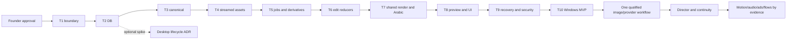

# Yamakan master implementation plan — final proposal

## Canonical entry point (frozen 2026-10-18)

This file is the canonical entry point to the Yamakan plan. **Implementation of the frozen plan has not started.** It begins only on the founder's start authorization.

| Read in this order | For |
|---|---|
| [START_HERE_WHEN_READY.md](START_HERE_WHEN_READY.md) | The single starting point when development is authorized |
| [PLAN_FREEZE_MANIFEST.md](PLAN_FREEZE_MANIFEST.md) | The frozen commit, source pins, document hashes, external gates and assumptions |
| [07 Optimized master plan](research/rea-source-reuse/07_OPTIMIZED_MASTER_PLAN.md) | Final architecture (B, balanced reuse on D′), phases, the M-gate |
| [04 Exact source import blueprint](research/rea-source-reuse/04_EXACT_SOURCE_IMPORT_BLUEPRINT.md) | Frozen donor selections and file-level mapping |
| [08 Implementation tasks](research/rea-source-reuse/08_IMPLEMENTATION_TASKS.md) | All 18 task cards (W1–W18), the dependency graph and qualification tests Q1–Q14 |
| [13 First implementation wave](research/rea-source-reuse/13_FIRST_IMPLEMENTATION_WAVE.md) | The first ten PRs, starting with W1 |
| [FUTURE_CLAUDE_EXECUTION_PROMPT.md](FUTURE_CLAUDE_EXECUTION_PROMPT.md) | The prompt to paste when development is authorized |

**Order of authority:**

- T1–T10 below are merged (PRs #1–#28). The MVP release gates in this file and in the [release proposal](RELEASE_PROPOSAL.md) stay authoritative.
- The phases P05–P09 below are superseded by the reuse-first plan (07), and the open MVP work is tasks W1–W7 there. Where this file and 07 differ on P05–P09, 07 applies.
- The sections below are kept as the approved historical plan (`edbaba6c`).

**CONDITIONAL GO for scoped implementation after founder approval; NO-GO for release today.** (Historical text of the 2026-10-11 plan; the canonical entry point above governs.) Final optimization starts at live PR #4 head `73910ba9db870a68c9b08c7c369c4bdd1ff3f420`, following original PR #3 `419bc356eaa6738ba546f38310687739177da6bb`. Main remains `0d3bdacb51188294ba8d36ce2b218db72f6073a6`. Claude's [review](review/CLAUDE_INDEPENDENT_REVIEW.md) and entire evidence directory remain unchanged. Approval binds the exact final proposal commit. No implementation is authorized by this document.

Read the [founder packet](FOUNDER_DECISION_PACKET.md), [assessment](review/FINAL_OPTIMIZATION_REVIEW.md), [contracts](OPERATIONAL_CONTRACTS.md), [source matrix](SOURCE_IMPORT_MATRIX.md), and [acceptance](E2E_ACCEPTANCE.md). The historical `docs/evidence/yamakan/phase-plan.json` describes the original proposal only.

## Architecture and accepted product

Retain D′: React/TypeScript local web, Node 24 command service, **one SQLite authority**, immutable content-addressed media, one canonical project/timeline, owned FFmpeg export and libass typography. Refine it by storing canonical snapshot bytes inside the DB transaction, separating jobs from attempts with fencing, and providing FFmpeg reference preview. Fast interactive preview is a measured optimization. No donor persistent store, whole application or alternate renderer becomes canonical.

First accepted product: offline launch → create → import real media → scenes/shots → multitrack timeline → titles/audio → play/seek/reference preview → playable MP4 → save/reopen → interruption recovery → equivalent API/MCP journey. Arabic/English layout, mixed-script titles, accessibility, bounded resources and real Windows tests are mandatory. Camera metadata is labeled intent. No fake generation panels.

Defer GPU inference, cloud accounts/billing, desktop installers, 3D generation, collaboration servers, plugin runtimes, advanced masks/retime/crossfades and portable media archives. Backup/recovery remains mandatory. Archives are a separate post-MVP feature with the retained malicious-entry gate: the requested first slice does not require another portable parser/publication surface.

## First ten implementation PRs

Each row is one bounded PR tested through its named contract. Preserve existing tests and use meaningful fixtures/fault seams. If a row exceeds about four builder days after discovery, split at its interface and re-estimate. Reviewer means a fresh independent reviewer of the immutable diff. Effort excludes approval/CI waiting.

| # / dependency | PR scope | Definition of done and evidence | Owner / conditional days |
|---|---|---|---|
| 1 / approval | **Command boundary and import guard.** Shared versioned envelope/errors, resource policy and provenance exclusions; adapt current dispatch; typed TS client and registry-derived MCP stdio shell | Negative schema/scope fixtures; excluded donor path rejected; existing offline prototype passes. No protocol invokes raw shell/filtergraphs. Browser and explicit local clients have distinct authentication paths | Builder + Reviewer; 1–2 |
| 2 / 1 | **SQLite snapshot commit.** Snapshot bytes, heads, revisions, receipts and outbox in one transaction; OS-released service lock and busy policy | Forced two-process CAS: one commit/one conflict; same-request retry returns original result; different payload rejected; kill before/after commit; restart no manual unlock; reopen requires no external snapshot. DB integrity and byte receipts | Storage builder + Reviewer; 2–4 |
| 3 / 2 | **Canonical v1 and migration.** Checked flicks/rational math, source PTS, refs, pure legacy migration and future-version inspection | Original-root hashes unchanged; source timing/render intent preserved; numeric/property fixtures; unknown version refuses writes; recovery exports exclude secrets/paths | Storage builder + Reviewer; 2–3 |
| 4 / 3 | **Streaming assets and owned probes.** Skelet streaming CAS, no-overwrite publication, native service-owned atomic Job Object launch binding, bounded probe/range streams | ≥2 GiB import within memory ceiling; launch-seam/service/launcher kills leave no live or suspended ffprobe; collision/corruption/Windows sharing and injected ENOSPC tests; no incomplete metadata refs; local/remote playlist subresources denied. VFR identified, editing waits for T5 derivative | Media/runtime builder + Reviewer; 3–6 |
| 5 / 2,4 | **Durable media jobs.** SQLite jobs/attempts/leases, cancel/validation/fencing, reuse T4 ownership binding for FFmpeg, VFR/proxy jobs and bounded cleanup | Bad payload quarantined; page corruption blocks safely; >10,000 historical jobs do not exhaust active admission; cancel/complete race; launch-seam/service/launcher kills leave no live or suspended FFmpeg; partial artifacts unregistered; VFR timing/provenance fixtures | Runtime builder + Reviewer; 3–5 |
| 6 / 3,5 | **Timeline reducers and donor adapters.** Scene/shot, track/clip add/trim/split/move/lock/target, title/audio/gain/fades, atomic batch and revision-bound undo/redo; retain editing views | Ten-operation UI/tool fixture produces specified snapshot; stale undo conflicts; failed batch commits nothing. Adapt OpenCut snapping/placement behind checked time/types; failing fixtures corrected and qualified before enabled use; no donor `EditorCore`/storage | Editing builder + Reviewer; 2–4 |
| 7 / 5,6 | **Render plan and typography.** Versioned compiler, shared FFmpeg argv, output validation, ASS/libass and pinned OFL fonts | Capability probe fails closed; real Arabic/Latin/punctuation/digit/diacritic goldens reviewed; plain text cannot inject ASS overrides; ffprobe/frame/audio receipts; ENOSPC/cancel never publishes output | Media builder + Arabic reviewer; 3–5 |
| 8 / 7 | **Useful preview and assembled UI.** Plan-keyed frame/segment reference preview, bounded cache, play/seek and measured fast interaction; localized UI | Current preview revision visible; boundary/font/color fixtures; reference/export comparison at same profile; fast subset passes ROI/type-specific tests; latency/playback usable. JASSUB only after separate qualification | UI/media builder + Reviewer; 3–5 |
| 9 / 2,8 | **Recovery, backups and local boundary.** Online DB backup + pinned assets, restore-to-new-root UI, draft download, token ACL, loopback hardening | Restore destination-snapshot hashes during concurrent import/edit/GC; corrupt DB/WAL/assets preserved/diagnosed; second Windows account denied; other loopback port cannot obtain credentials/read media; authenticated CLI/MCP works; keyboard/RTL journey | Security/storage builder + Reviewer; 2–3 |
| 10 / 1–9 | **Windows qualification and release proposal.** Pinned runtime/FFmpeg/fonts/notices, clean-host journey, CI/fault matrix and independent release review | Every MVP gate passes at exact release head with MP4, probe/frame/audio, MCP/UI snapshots, network/process capture and artifact hashes; no release-blocking finding; founder artifact-bound ship decision | Reviewer + Founder; 3–5 |

T1–3 gate feature merges: no mutation expansion lands on the demonstrated unsafe store. A bounded reference-preview latency spike runs alongside T2 using a frozen sample plan/ASS before committing to T8 complexity; it produces no production renderer. Independent reversible UI/source spikes may proceed while DB work continues. OpenCut qualification has a two-day spike budget during implementation; if integration fails, retain current proven primitives for the minimal set and defer depth. Do not rebuild advanced functionality already in a donor.

## Dependency order and phase gates

| Phase | Deliverables / dependency | Imports and boundaries | Acceptance / performance / evidence | Risk, recovery and owner |
|---|---|---|---|---|
| P00 approval | Final proposal and retained evidence | No production code/imports | Founder records scoped choices at exact commit; PR chain/CI verified | Pending approval; Founder |
| P01 authority | T1–3 after approval | Ninerr + schema guards; built-in SQLite behind interface | CAS/replay/migration/kill receipts; target 2 MiB commit p95 ≤100 ms on stated SSD | SQLite API/build stability; replacement binding only behind same qualified contract. Storage builder |
| P02 media/runtime | T4–5 after P01 | Skelet; Gomrey rules only; one job system | Stream/probe/VFR/recovery corpus; ≤300 MiB service RSS for ≥2 GiB import, separately bounded decoder | Disk/locks/decoder; stop admission and retain staging. Runtime builder |
| P03 offline film | T6–8 after P02 | Existing filmmaker UI, bounded OpenCut, FFmpeg/libass, optional JASSUB | Real multitrack/MP4/Arabic/parity; 720p playback ≥24 fps target; reference still ≤1 s warm/≤3 s cold, 2 s segment ≤6 s cold; 30 s fixture export ≤3× real time target | Latency is a gate; narrow proxies/segments/cache before another renderer. UI/media builder |
| P04 MVP release | T9–10 after P03 | Pinned distribution; no generative runtime | Full MVP gates, clean Windows profile, independent exact-diff review; reopen ≤2 s, launch ≤5 s target | ACL/backup/Windows faults; don't advertise untested limits. Reviewer + Founder |
| P05 desktop/interchange | Optional ADR after P01; release after P04 | Fresh shell; reuse already-qualified MVP lifecycle binding; OTIO interchange; archives separate | Codec/IPC/Job Object/install/update tests; hostile archive corpus | Neither shell qualified; keep local web when spike fails. Desktop builder |
| P06 Studio/Cinema/router | P04 + separately approved F/G | ArtCraft camera adapters, InvokeAI canvas candidate, official provider or isolated ComfyUI | One entitled operation with output/hash/quality/cost/privacy receipt; manual staging works alone | Hardware/accounts unqualified; disable route. Engine builder + Founder |
| P07 Director | Qualified P06 stage contract; manual storyboard can precede AI | OpenMontage manifests/gates, OpenVideoStudio identity contracts; no second store/scheduler; StoryMind reference | Approved script→shots→takes→timeline resume; blinded multi-shot continuity | AGPL/grants/continuity; no inference claim from fixture metadata. Director builder |
| P08 Motion/Audio/Ads/Flow | Selected P06/P07 pieces | WanGP/ComfyUI workers, CPU transcription first; registered xyflow UI; variant export | Every operation runs/cancels/restarts on named hardware; no duplicate spend; masks/retime have parity fixtures | No auto-installed custom nodes/dynamic code; sequential fallback. Engine builder |
| P09 Agents/Quality/Collaboration | MVP commands already delivered; advanced commands follow P06–8 | Thin SDKs, Ascout lineage concepts, derived memory; separate remote boundary | Blinded Quality Lab; reproducible comparisons; explicit capability status; separate remote auth review | No chat-memory authority; revision proposals before CRDT redesign. Reviewer |

Performance values are **proposed targets**, not measured results. Freeze the versioned qualification policy, fixtures, limits and hard pass thresholds as specified in the operational contracts before T4/T8; no acceptance row passes against an unspecified or silently weakened profile. Profile A: Windows 10 22H2+ x64, local NTFS, four CPU cores, 8 GiB RAM, integrated graphics and enough disk for inputs + derivatives + output + reserve. Capture actual CPU/storage/RAM/FFmpeg/browser and distributions. Dynamic disk preflight replaces an arbitrary fixed minimum that may not fit 4 GiB footage. Profile B/C are optional per-operation hardware/BYOK qualifications.

## Product expansion and differentiation

Director, Cinema, Studio, Edit, Motion, Audio, Ads, Flow, Agents, Quality Lab and Smart Router are coherent views of the same versioned assets/commands/jobs/approvals. Publish no empty studio as enabled. [Competition](COMPETITOR_MATRIX.md) separates existing prototype, qualified source, planned, unverified and research states.

First expansion: one real versioned image take, one entitled official adapter or local engine, one approved script-to-shot workflow. Then continuity, applied camera/pose control, transcription/subtitles, brand variants and durable batches. Enable Seedance, Wan, Kling, Hailuo or any other name only for the exact qualified operation/adapter/account/region/price/runtime. Extend effect registry/plan before exposing donor controls; text accepted in a prompt is not proof of applied camera control.

Quality Lab precedes ranking: shared consented inputs, failure/attempt accounting, blinded creator ratings, identity/motion/typography artifacts, latency and charged cost. Router hard-filters eligibility before ranking and returns rejection reasons. Transactional BYOK intent/reservation/reconciliation prevents automatic ambiguous resubmits. Collaboration begins with revision-bound proposals/conflicts; CRDT and remote tenancy need an independent evidence-backed decision.

## Delete, combine and postpone

Exclude future competing file-journal job authority, duplicated transport validators, raw renderer filters, whole-app donor bootstraps and lifetime-job limits. Preserve reviewed history/evidence. Combine preview/export under one compiler, mutations under one registry, async work under one supervisor and studio views under common asset/project components.

Postpone archives, broad SDKs, JASSUB fast path, packaging, advanced masks/retime, native VFR editing, smart-ranking optimization, GPU downloads, remote collaboration, subscriptions/resale and plugin execution. Backup and correct VFR import remain mandatory. Freeze pins rather than continuously upgrading the inventory. New adoption requires a measured advantage over the selected module; the [source matrix](SOURCE_IMPORT_MATRIX.md) records two discoveries without adding whole stacks.

## Blocker ownership, effort and approval

| Gate / owner | Evidence required | Effect |
|---|---|---|
| B1 / Storage builder | Production CAS/in-DB snapshot/backup/migration fault matrix | Blocks mutation expansion/release |
| B2 / Security reviewer | Enforced exclusions and deny-by-default imports | Blocks affected imports |
| B3 / Runtime builder | Job fencing/cancel/restart/retention | Blocks durable export/derivatives |
| B4 / Runtime builder | Native service-bound atomic Job Object assignment before execution; launch-seam, service and launcher death paths | Blocks direct FFmpeg/ffprobe MVP launch; descendant workers have additional later tree tests |
| B5–6 / Media + Arabic reviewers | Reference latency, glyph/ROI parity, font/build pins | Blocks offline release |
| Release / Reviewer | Actual disk-full, NTFS locking, second-account ACL, malicious media, offline capture, backup restore | Blocks release; Linux CI insufficient |
| Paid routes / Founder + adapter builder | Entitlement, bounded quote/consent and approved capped runtime tests | Blocks route enablement; no MVP dependency |

Conditional effort: **24–42 builder working days**, plus **5–10 contingency days** for Windows findings and review latency, assuming one experienced builder and existing prototype reuse. This is an estimate, not measured speedup. Re-estimate after T2/reference-latency spike/T5 native lifecycle qualification; donor integration is bounded by its spike budget. Desktop adds estimated 8–15 days after ADR. Limited AI/Director expansion adds 8–16 weeks after hardware/accounts/licenses. No credible estimate covers world leadership or every source engine.

Founder approves mandatory MVP choices A/B/C/E/I/J in [the packet](FOUNDER_DECISION_PACKET.md); D/F/G/H may explicitly stay deferred. Approval does not merge planning PRs, release production, enable paid inference or rename the repository. Future PRs use exact-head CI, independent review, normal merges and verified main. Stop at approval.
