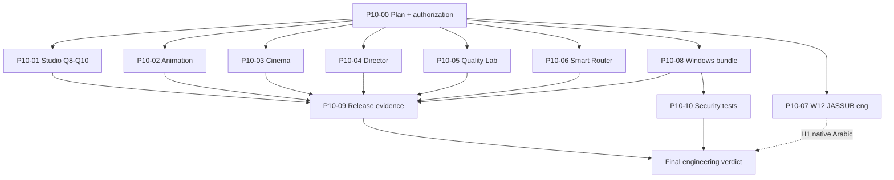

# P10 dependency graph

## Hard dependencies

| Card | Blocks |
| --- | --- |
| P10-00 | All implementation cards |
| P10-01 enablement | Studio rows in release evidence |
| P10-08 | Artifact-bound security/release rows |
| H1 (external) | W12 / JASSUB enablement |
| H2–H5 (external) | Release GO |

## Parallelism

After P10-00, P10-01 through P10-08 may proceed in parallel on isolated branches/worktrees. Prefer completing P10-01 first when capacity is serial. P10-09 should re-run after any enablement merge. P10-10 may start on achievable unit/containment tests anytime; artifact-bound rows wait for P10-08.

## Tie-break (serial)

1. P10-00  
2. P10-01 Studio  
3. P10-02 Animation  
4. P10-05 Quality Lab + P10-06 Router (small, independent)  
5. P10-03 Cinema  
6. P10-04 Director  
7. P10-07 JASSUB eng + H1 packet  
8. P10-08 Bundle  
9. P10-10 Achievable security  
10. P10-09 Release evidence refresh  
11. Verdict
