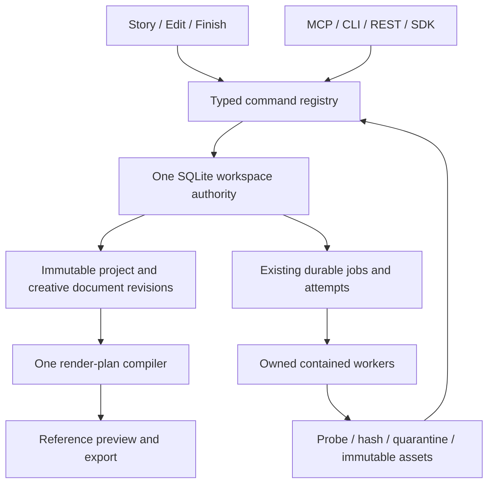

# Final target architecture and interface specification

**Proposed; none of this document implements production functionality.** Preserve one workspace SQLite database, one canonical project head, existing asset publication/GC, command registry, JobSupervisor, process owner, reference render and FFmpeg export. Source baseline and actual limitations: [01](01_CURRENT_CODEBASE_AUDIT.md). Existing invariants: `docs/OPERATIONAL_CONTRACTS.md`.

## Authority map



Frontend state is a projection plus ephemeral interaction state. An autosave indicator means an acknowledged committed revision, never a local hash. A job's output becoming available does not attach it to a project; attachment is an explicit revision-bound command. No donor worker writes the database.

## Canonical creative documents

Evolve canonical format v4 to **v5** with a bounded optional `documents` list of `{id, kind, schemaVersion, contentHash}`. Kinds initially `studio`, `cinemaScene`, `story`. Do not embed eight-megabyte canvas JSON in every project snapshot. Add immutable `creative_documents(hash PRIMARY KEY,kind,schema_version,bytes,byte_length)` and `snapshot_document_refs(snapshot_hash,document_hash)` in **the existing database**. Typed document validation derives all referenced media; include that closure in the existing snapshot asset-reference index. A document hash is canonical serialized validated content, with UTF-8 byte limits enforced before expensive parsing. This is one project authority with immutable subordinate blobs, not an independently mutable document database.

`ProjectStore.commitCreativeDocument({projectId,expectedRevision,documentId,kind,expectedDocumentHash,stagedUploadId,contentHash,receipt,writerId})` resolves a sealed staged upload as specified below, validates and reads its bounded bytes outside the write transaction, then deduplicates the immutable document, replaces its canonical reference, checks all media objects ready, writes snapshot/refs/history/receipt/outbox and advances exactly one project revision in one SQLite transaction. No filesystem, subprocess or network awaits inside that transaction. Return `{revision,snapshotHash,documentHash,eventCursor}`. Duplicate receipt returns the original result before revision comparison; changed digest fails. Stale hash or revision yields `REVISION_CONFLICT`.

### Document transport without widening command limits

The existing2MiB general request/snapshot limits remain unchanged. An8MiB canvas cannot be embedded in an ordinary command envelope. Add a separately authenticated, project-scoped **streamed staging route** `POST /v1/projects/:projectId/documents/stage` with a document-specific versioned policy: raw body<=8MiB and canonical serialized UTF8 document<=8MiB,JSON depth<=64,canvas nodes<=10000 and existing dimension/megapixel bounds. These are proposed route-specific ceilings; implementation must test memory/disk admission and may lower the supported limit with explicit UX. The limit covers the **entire encoded document**, including JSON-escaped `canvasJson` and metadata; an8MiB string measured in UTF16 code units is not guaranteed persistable. Reject embedded bitmap/base64/URL payloads; pixels use existing managed asset uploads.

Authorize origin/session/principal/project and reserve bytes before streaming. Server-owned private staging holds bounded data; hash, validate nested canvas/asset/schema semantics and seal it. Return only `{stagedUploadId,contentHash,byteLength,kind,schemaVersion,expiresAt}`. A DB upload receipt binds handle/hash/project/principal/kind and request digest; clients never receive a host path. Propose15minute expiry,at most2active uploads/principal and16MiB aggregate reservation/workspace, subject to disk policy. Lost-response stage retry returns the same sealed receipt; changed request digest refuses. Staged content is not an acknowledged creative revision.

Small `document.commit` commands carry only the sealed handle/hash,expected revision/document hash and identity fields. Reopen/rehash/validate staged bytes outside the transaction, hold a publication/cleanup exclusion while committing, and insert document/ref/head/receipt together. Mark consumption in that transaction; receipt replay succeeds even after handle expiry/cleanup. An expired,foreign-project/principal,changed-byte or already-consumed-for-different-request handle fails without changing head. TTL cleanup handles abandoned uploads, active commits and crashes; no staged/orphan data becomes a project ref. Do not keep a DB transaction open while receiving an upload.

Browser and SDK stream through that same route; CLI's local reader uploads bytes, never passes a server host path. MCP commands use staged handles and a separately authenticated REST upload,as current media import already does, rather than bypassing frame limits or base64-inline bodies. Test actual REST/browser/SDK/CLI/MCP paths with2MiB boundaries,valid2–8MiB documents,over8MiB raw/canonical,escape expansion,Arabic/emoji UTF8,deep nesting,disconnection,TTL,replay,cleanup and concurrent CAS. Ordinary command/snapshot limits must remain enforced in all cases.

Studio's `saveStudioDocument` remains a pure validator/hash function; the registry's new persistence path must call ProjectStore. Cinema UUID scene IDs remain stable. Read commands require a project ID and resolve only its retained document refs. Imported canvas data is untrusted; validate nested asset references, dimensions, schema versions and bounded complexity, not just outer version fields.

### Migration and rollback

P0 records all sidecar files and hashes before any change. New migration inventories Cinema/Director data read-only, validates bounded JSON and maps project ownership explicitly. Existing Cinema scenes lack a reliable project linkage: stage them as **unassigned legacy documents**; require user selection rather than guessing ownership by filename or current project. Maintain original sidecars byte-for-byte. Migrate Studio local state only if it can be explicitly exported and associated; never claim lost browser session data is recoverable. An import receipt binds old file hash, owner mapping and new document hash. Interrupted migration resumes idempotently.

Old readers reject unsupported v5 writes. Rollback uses a verified pre-migration workspace copy; never downgrade by dropping documents. Export a v4-compatible projection only if losslessness checks pass or the user explicitly creates a separate reduced copy. Measure backup size/open latency before lifting limits. Keep one backup manifest covering DB, document refs and all referenced media.

### Shared activation gate and legacy saves

**AG-DOCS** holds new v5 mutation commands, default migration and UI persistence behind a server-owned flag initially false until YU010–015 qualify together. Individual task receipts may verify a flag-off implementation in isolated fixtures; they cannot claim live creative persistence activation. Group acceptance requires v4/v5 open/save/undo/reopen, nested bitmap closure, concurrent writers, complete backup/restore and actual browser/client paths. Activation is an explicit later reviewed change, not an incidental consequence of merging a schema task. Existing enabled creative panels keep their accurately labeled legacy limitations until this gate passes.

Every legacy/full-project save and edit-view conversion must preserve creative refs and required nested media/scene/shot state losslessly. If an old client cannot express a safe mutation, reject it with a versioned unsupported/lossy-save error and return the current revision; never silently replace a v5 snapshot with a v4 projection or discard opaque refs. A30fps view is not permission to round a newer rational-rate project. YU015 must test real UI Save and every existing project.save/migration/import path, not only newly added typed commands.

## Security and workflow state

Consent is **workspace security state**, not undoable artistic history. Add consent grants/revocations and identity-encoding validity to versioned append-only ledger tables in the same DB, linked by stable IDs. Restoring an artistic revision cannot resurrect a revoked grant. Restore into a new workspace imports grants as requiring human revalidation unless an explicit security policy proves continuity; no provider credential is in project or backup JSON.

### Restore is not execution authorization

Restoration or portable import creates a fresh **workspace execution identity/epoch**, distinct from preserved artistic project IDs. Fence every source lease/attempt and place restored queued/running/validating/cancel-pending jobs, workflow effects and proposals under a durable `restoreHold` with `RESTORED_WORKSPACE` reason. Existing supervisor startup must inspect this hold **before** requeue/recovery; copied DB rows cannot automatically resume work. Keep pending approvals invalid until a new human review binds restored revision, refs, new execution epoch and current consent. Restored terminal receipts remain immutable historical evidence, not permission to republish/attach effects.

Retain provider account/request IDs, submission intents, uncertain outcomes and reservation/charge evidence for read-only reconciliation. A restored copy must neither submit again nor release an unresolved reservation/refund by assumption; the original workspace may still be running. No credentials are restored. Explicit authorized reconciliation against the actual provider/account determines external outcome and shared budget before any new effect. An explicit new approved command creates a new job/attempt in the new epoch after hold/consent/proposal checks; it never resurrects an old lease. Even local renders require explicit restart rather than silently running on first open. Backup inspection and restore stay usable offline.

Test backups taken before submit, after remote acceptance/before ID persistence, during run, after completion/before attachment, after approval, after revocation and while an original workspace remains active. Restore/open and repeated service restarts must produce **zero worker spawns, provider requests, attachment publications or automatic reservation releases**; loss/ambiguous state remains visible. User-authorized reconciliation/restart must be idempotent and cannot double-charge or revive a stale approval.

Director story/shot descriptions are revisioned creative documents. Executions use `director_runs` and `director_stage_attempts` in the same DB, referencing JobSupervisor jobs and immutable output hashes; no second scheduler. State changes CAS a run version and use command receipts. Approval binds `{runId,stageId,projectRevision,proposalHash,outputHash,expiry,grantor}`. Any changed input/output invalidates approval. Approval-required transitions can only be executed by existing browser human principals. Store run receipts with backup roots; never trust a user-supplied hash as proof a model/render ran.

## Command transport contract

Retain `core/command/registry.ts` authorization, derived principals, bounded strict schemas and REST/MCP/CLI/SDK parity. Add `yamakan.document.{get,list,commit,importLegacy}`; document mutations require expected project revision and expected document hash. Add typed timeline/effect/shot operations to the existing reducer. Browser gestures end in one command or bounded applyBatch, while local drag projections reconcile the committed response. Save is no longer a competing full-project edit path for ordinary editing. Undo is a new writer-scoped revision and must include documents.

Structured failures: existing `VALIDATION`, `REVISION_CONFLICT`, `IDEMPOTENCY_MISMATCH`, `SCOPE_DENIED`, `LIMIT_EXCEEDED`, `RECOVERY_REQUIRED`, `CAPABILITY_UNAVAILABLE`; new versioned engine reason codes are domain data within capability/job results. Do not rename existing errors without migration tests.

## Model-independent EngineAdapter v2

The existing v1 remains in place until a versioned bridge qualifies. Proposed service-facing types:

```ts
type AssetRef = { assetVersionId: string; sha256: string; mediaType: string };
type Operation = 'textToVideo'|'imageToVideo'|'videoEdit'|'transcribe'|'enhance';
type EngineRequestV2 = {
  contract: 'yamakan.engine-adapter/v2'; operation: Operation;
  recipeId: string; recipeHash: string; modelManifestHash: string;
  prompt?: string; inputs: {role: string; asset: AssetRef; atTicks?: number}[];
  output: {width:number;height:number;fps:{num:number;den:number};durationTicks:number};
  seed?: number; controlsHash?: string;
  attemptKey:string; leaseGeneration:number; deadlineMs:number; resourcePolicyHash:string;
};
type CapabilityV2 = {
  operation: Operation; available:boolean;
  reason?: 'ENGINE_DISABLED'|'WEIGHTS_ABSENT'|'HARDWARE_UNQUALIFIED'|'RIGHTS_UNQUALIFIED'|'CONTROL_UNSUPPORTED';
  qualificationHash?:string; constraintsHash:string;
};
type Cancellation = {requested:boolean; localProcessExited:boolean;
  remoteAcknowledged?:boolean; remoteOutcome?:'stopped'|'continuing'|'unknown';
  billingOutcome?:'notApplicable'|'refunded'|'charged'|'unknown'};
```

Each operation is implemented with its own strict discriminated schema; the illustrative broad type is not permission for arbitrary roles or unknown controls. No model class name, URL, Python code, filesystem path or free-form graph crosses a public command. Capability constraints enumerate actual model limits, audio support, reference counts, resolution/duration combinations and measured control support. UI never promises a control merely because it can store metadata. Resolve immutable handles to files only inside the trusted service; do not allocate entire input/output videos as byte arrays.

`submit(request,context)` returns an external execution reference tied to the existing durable attempt; `status`, `requestCancel`, `enumerateArtifacts` and `reconcile` return bounded structured observations. Sidecar status is not canonical job state. Framed stdio has a version handshake, maximum control-frame length, bounded diagnostics and a deadline; media travels through restricted per-attempt files. Outputs are stage-relative server-validated paths/handles, lengths and hashes; service reopens, probes and hashes before object publication. Fence every publication by attempt generation and cancellation predicate.

The v1 bridge maps only server-owned allowlisted recipe templates to graphs for deterministic fake tests or a separately qualified worker. Arbitrary user graph input stays forbidden. Plume adds a new implementation and qualified manifest, not another schema/database/scheduler.

## Provider semantics and cost

Providers remain disabled. A future provider adapter gets only specifically approved egress and vault access. Persist quote/reservation/submission intent before send. Pin provider/model/API version and quote expiry. Timeout with unknown submission means `reconciliationRequired`, never automatic resubmit. Polling SDK loops are observations underneath the durable supervisor. Distinguish cancel requested, remote acceptance, actual stop and refund. Downloaded URLs go through SSRF/redirect/byte/format controls, immutable asset publication and consent checks. Never expose provider keys in browser or MCP output.

## Render and media boundary

Use one typed render plan for reference preview and final export; interactive preview identifies its qualified subset. Extend rational-time projection deliberately before offering non30fps. Effects declare render version, parameter bounds, color assumptions and preview support. SDR Rec.709 remains first; unsupported HDR is rejected rather than silently clipped. Source proxies and waveform/thumbnail derivatives key on source hash, compiler/profile/version; cache eviction never deletes original media or retained revision roots.

No per-frame filter-stage expansion for long animation: qualify compact expressions or bounded segments against sampled canonical curves. GPU compositing or native MLT preview is a decision spike, not a hidden replacement for FFmpeg semantics. [12](12_PROFESSIONAL_EDITING_ROADMAP.md) defines the escalation conditions.
