# Task dependency graph and execution order

Generated from [TASK_REGISTRY.json](TASK_REGISTRY.json); graph data in [DEPENDENCY_GRAPH.json](DEPENDENCY_GRAPH.json). No circular dependency is permitted. Phase numbers describe product workstreams, not barriers requiring every earlier optional feature. No implementation is authorized now.

## Dependency DAG

```mermaid
flowchart TD
  YU000["YU-000: Freeze artifact-bound baseline and capability evidence"]
  YU001["YU-001: Reproduce dependency/native/browser baseline in an isolated test workspace"]
  YU002["YU-002: Make Quality Lab evidence validation and digest complete"]
  YU003["YU-003: Bound MCP frames and concurrent requests"]
  YU010["YU-010: Add immutable creative document references to canonical v5"]
  YU011["YU-011: Persist Studio canvas and bitmap assets through document commands"]
  YU012["YU-012: Migrate Cinema sidecars with explicit project assignment"]
  YU013["YU-013: Move Director attempts and consent/revocations into existing SQLite"]
  YU014["YU-014: Prove complete creative backup/restore closure"]
  YU015["YU-015: Route browser editing through canonical operations and durable undo"]
  YU016["YU-016: Generate bounded immutable waveform peak tiles"]
  YU017["YU-017: Add indexed thumbnails and proxy policy"]
  YU018["YU-018: Qualify preview cache/audio clock and visible parity subset"]
  YU019["YU-019: Qualify rational project fps across view/edit/render"]
  YU020["YU-020: Implement a typed transform/crop effect with preview/export parity"]
  YU021["YU-021: Add one frame-exact crossfade transition"]
  YU022["YU-022: Replace frame-sized animation filter chains with bounded compilation"]
  YU023["YU-023: Qualify SDR color metadata and bounded LUT import"]
  YU024["YU-024: Add editable imported caption tracks"]
  YU025["YU-025: Implement verified relink and batch aspect/export variants"]
  YU026["YU-026: Qualify scale profiles before raising project limits"]
  YU030["YU-030: Unify Story/Edit/Finish navigation and project selection"]
  YU031["YU-031: Add story/shot/reference pack lifecycle"]
  YU032["YU-032: Implement non-destructive take compare/replace"]
  YU040["YU-040: Introduce operation-based EngineAdapter v2 with artifact handles"]
  YU041["YU-041: Qualify new worker profile using no-model stand-ins"]
  YU042["YU-042: Prove missing-weights and qualification discovery without downloads"]
  YU043["YU-043: Close first-engine source/runtime manifest and qualification choice"]
  YU050["YU-050: Compile cinematic intent to explicitly supported conditioning"]
  YU051["YU-051: Version continuity references and consent checks at attempt/attach"]
  YU060["YU-060: Add revision-bound creative proposals with human review"]
  YU061["YU-061: Execute resumable three-shot imported-media production"]
  YU062["YU-062: Expose stable request IDs and progress parity across transports"]
  YU070["YU-070: Qualify transcription contract/native stand-in before weights"]
  YU071["YU-071: Qualify deterministic repair/analysis operations"]
  YU072["YU-072: Qualify neural enhancement/interpolation source and weights later"]
  YU080["YU-080: Produce portable creative project with explicit interchange loss"]
  YU081["YU-081: Evaluate selective revision as a complete product advantage"]
  YU090["YU-090: Build benchmark recording and analysis harness without outputs"]
  YU091["YU-091: Run affected Windows editor/recovery/performance qualification"]
  YU092["YU-092: Run real engine and comparative A/V quality qualification only with F"]
  YU093["YU-093: Perform native Arabic and product usability evaluation"]
  YU100["YU-100: Collect exact-artifact release gates without shipping"]
  YU101["YU-101: Execute external clean-profile/account/disk/signing/founder gates"]
  YU000 --> YU001
  YU001 --> YU002
  YU001 --> YU003
  YU001 --> YU010
  YU010 --> YU011
  YU010 --> YU012
  YU010 --> YU013
  YU011 --> YU014
  YU012 --> YU014
  YU013 --> YU014
  YU010 --> YU015
  YU001 --> YU016
  YU016 --> YU017
  YU017 --> YU018
  YU015 --> YU018
  YU015 --> YU019
  YU018 --> YU019
  YU019 --> YU020
  YU020 --> YU021
  YU019 --> YU022
  YU020 --> YU023
  YU019 --> YU024
  YU015 --> YU024
  YU014 --> YU025
  YU020 --> YU025
  YU018 --> YU026
  YU019 --> YU026
  YU022 --> YU026
  YU016 --> YU026
  YU011 --> YU030
  YU012 --> YU030
  YU013 --> YU030
  YU015 --> YU030
  YU010 --> YU031
  YU013 --> YU031
  YU030 --> YU031
  YU031 --> YU032
  YU020 --> YU032
  YU002 --> YU032
  YU010 --> YU040
  YU003 --> YU040
  YU040 --> YU041
  YU001 --> YU041
  YU040 --> YU042
  YU041 --> YU042
  YU042 --> YU043
  YU031 --> YU050
  YU040 --> YU050
  YU031 --> YU051
  YU013 --> YU051
  YU040 --> YU051
  YU015 --> YU060
  YU013 --> YU060
  YU032 --> YU060
  YU060 --> YU061
  YU014 --> YU061
  YU031 --> YU061
  YU003 --> YU062
  YU060 --> YU062
  YU061 --> YU062
  YU024 --> YU070
  YU041 --> YU070
  YU042 --> YU070
  YU017 --> YU071
  YU040 --> YU071
  YU043 --> YU072
  YU019 --> YU072
  YU071 --> YU072
  YU014 --> YU080
  YU025 --> YU080
  YU031 --> YU080
  YU032 --> YU081
  YU061 --> YU081
  YU080 --> YU081
  YU002 --> YU090
  YU000 --> YU090
  YU026 --> YU091
  YU014 --> YU091
  YU030 --> YU091
  YU024 --> YU091
  YU025 --> YU091
  YU062 --> YU091
  YU090 --> YU091
  YU043 --> YU092
  YU050 --> YU092
  YU051 --> YU092
  YU090 --> YU092
  YU041 --> YU092
  YU030 --> YU093
  YU024 --> YU093
  YU081 --> YU093
  YU090 --> YU093
  YU091 --> YU100
  YU093 --> YU100
  YU100 --> YU101
```

## Dependency waves

A wave contains tasks at equal structural depth, not automatically safe parallel edits. Every task still needs its own verified dependencies, authorization, resource class and file owner.

- Wave 0: YU-000.
- Wave 1: YU-001.
- Wave 2: YU-002, YU-003, YU-010, YU-016.
- Wave 3: YU-011, YU-012, YU-013, YU-015, YU-017, YU-040, YU-090.
- Wave 4: YU-014, YU-018, YU-030, YU-041, YU-071.
- Wave 5: YU-019, YU-031, YU-042.
- Wave 6: YU-020, YU-022, YU-024, YU-043, YU-050, YU-051.
- Wave 7: YU-021, YU-023, YU-025, YU-026, YU-032, YU-070, YU-072, YU-092.
- Wave 8: YU-060, YU-080.
- Wave 9: YU-061.
- Wave 10: YU-062, YU-081.
- Wave 11: YU-091, YU-093.
- Wave 12: YU-100.
- Wave 13: YU-101.

## Critical path and shortest credible outcome

Longest structural chain: `YU-000 → YU-001 → YU-010 → YU-015 → YU-018 → YU-019 → YU-020 → YU-032 → YU-060 → YU-061 → YU-081 → YU-093 → YU-100 → YU-101`. This is a dependency critical spine, not a duration-weighted schedule; no observed development durations support a calendar promise. H1–H5, actual humans/admin/signing, source closure and model hardware/rights can dominate elapsed time independently.

The shortest useful creator milestone is YU000/001 → YU010 → YU011/012/013 → YU014, plus YU015. It proves saved canvas/scene/run, common command undo, export and complete restore without generation. A manual three-shot story extends through YU030/031/032/060/061. Bounded waveform/proxy work may run in a separate lane after baseline, with serialized edits to shared registry/store/jobs files.

## Safe parallelism and milestones

- Baseline first: YU000/001. Then bounded YU002 Quality Lab and YU003 MCP may proceed independently.
- One DB/schema owner serializes YU010–014; Studio/Cinema/UI adapters can be prepared separately after the shared schema/contract is frozen.
- YU016–018 media improvements have a separate UI/media lane, but core/jobs/store conflicts require owner coordination.
- UI story/finishing work and flag-off engine schemas can progress after their dependencies without weights; do not block editing on F.
- Caption/transcription interfaces are independent of actual ASR weights; imported captions remain useful now.
- YU072/092/093/101 carry external gates; choose other READY tasks rather than bypassing them. Release can be evaluated for an explicitly offline capability set; optional model capabilities do not become implicitly authorized.

Keep PRs bounded to task interfaces. Do not stack a migration and unrelated native-engine rewrite. A prototype existence does not make a prerequisite VERIFIED. Recompute this graph and run the validator after any task dependency/state change.

## Activation groups are separate from build dependencies

AG-DOCS requires YU010–015 together, including lossless legacy-save and full backup/restore/browser-path evidence, before v5 default migration or user persistence activation. Individual tasks can be verified only in flag-off isolated scope; their receipts record activation status. Mutual group qualification is not a cyclic implementation prerequisite. Preserve acyclic build edges and require a separate group activation receipt.

## Early product checkpoint

After the integrity group qualifies, freeze one bilingual short-film finishing brief and observe a small formative creator/founder walkthrough before expanding later phases. Record task failures and revise priorities; this is not a powered comparative study. Defer broader studios/model breadth if the observed finishing journey is still confusing or unreliable.
