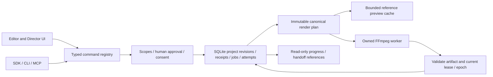

# R-05 final architecture assessment — independently qualified

Author: Astro. Date: 2026-11-02. Baseline: `c129a50c9e6bf9657f404c919c3cf6dbb8273697`. Evidence: professional systems [14](14_PROFESSIONAL_EDITOR_REA.md), generative/agent systems [15](15_GENERATIVE_AND_AGENT_SYSTEM_REA.md), media source qualification [16](16_MEDIA_SOURCE_QUALIFICATION.md), harness discovery [17](17_HARNESS_AND_ACCESSIBLE_SOURCE_REA.md), and the 16 [subsystem decisions](SUBSYSTEM_DECISIONS.json). The older [04](04_CURRENT_ARCHITECTURE_CHALLENGE.md) is retained historical challenge evidence; this document resolves its open design choices. The author is not an independent reviewer.

## Decision

Preserve canonical SQLite project/job authority and the shared FFmpeg render plan. Improve bounded interfaces, evidence and user interactions around the existing implementation. Combine option A (preserve/optimize) with option D (revision-bound proposals and derived read views) **using existing take proposal schemas**, not a generic new proposal framework. Option B is limited to qualified pure helpers already imported; option C retains the existing owned process supervisor, with no new worker runtime.

Arrows describe authority flow, not new services. Preview and handoff data are derived/discardable; neither may commit a project revision directly. Managed immutable objects remain outside SQLite with explicit validation/publication and backup closure. Database commit and file rename are not a power-loss durability proof.

## Alternatives challenged

| Criterion                    | A: existing authority and measured optimization            | B: replace with editor/media donor                                          | C: new durable/native worker platform                                       | D: existing proposals plus derived read views                                     |
| ---------------------------- | ---------------------------------------------------------- | --------------------------------------------------------------------------- | --------------------------------------------------------------------------- | --------------------------------------------------------------------------------- |
| Correctness / identity       | Preserves verified CAS, request receipts and integer time  | Donor track IDs, time units and state models require translation            | Requires new protocol/version and publication fencing                       | Current `TakeProposalSchema` already binds revision, story hash and exact mapping |
| Performance                  | M remains unqualified; profile before graph change         | No alternative measured against M                                           | Startup, copies and memory may exceed any benefit                           | No speed claim; bounded metadata work only                                        |
| Recovery                     | Retains leases, epochs, attempts and restore hold          | Requires migration and equivalent failure tests                             | Another scheduler/store can conflict with existing authority                | Discard stale proposals; accepted edits retain current transaction receipts       |
| Source reuse                 | Retains qualified imports and trust manifests              | Current OpenCut scaffold unusable; MLT/GStreamer/Remotion add large closure | Temporal/Vercel/private frameworks add incompatible operational assumptions | Adapts identity/uncertainty test concepts without copied runtime                  |
| Windows / offline            | Existing native process and runtime qualification retained | New ABI/codec/font/driver/package qualification                             | Must prove process-tree cleanup, ACLs and cross-account isolation           | Existing Node/SQLite/React; no network dependency                                 |
| Security                     | Familiar registry boundary; still requires negative tests  | New parser/plugin/asset surfaces and rights                                 | Process separation alone is not a sandbox                                   | Handoff cannot grant authority; exact apply remains registry/CAS checked          |
| Maintenance / migration cost | Lowest demonstrated change surface                         | New dependency/license/upstream drift burden                                | New state reconciliation and deployment burden                              | Bounded additive presentation; preserve old clients/documents                     |
| Verdict                      | SELECT                                                     | REJECT wholesale; narrow proven helpers only                                | DEFER new platform                                                          | SELECT narrow existing-schema integration                                         |

No measured evidence justifies replacing canonical storage, adding PostgreSQL/Mem0, adopting a workflow service or switching the media backend. This is an evidence-bounded choice, not a claim that the current system is optimal at every scale.

## Resolved contracts

1. **Creative authority:** Registered mutations retain the shared `ProjectStore` commit boundary: timeline/take edits use `applyOperations`, while save and guarded undo/redo retain their existing paths through `#commit`. Expected revision, request identity and transaction receipts stay authoritative. Existing snapshots may have scaling cost, but no measured transaction bottleneck supports a delta-store migration.
2. **Take proposals:** `yamakan.take.proposeReplace` is already read-only; `yamakan.take.apply` already recomputes the canonical proposal and validates story/media/continuity at commit. SS-006 renders this exact proposal in a derived Director review panel and submits the unchanged TakeProposalSchema payload to existing take.apply. This panel creates no durable proposal approval. The proposalHash is never a stage outputHash: advanceStage/approveStage continue to require a ready managed media object, and assertManagedOutput must not be widened. It does not implement another proposal engine, broaden single-clip shot support, or make all project mutations human-only.
3. **Approvals:** Director approval remains human-only. Ordinary scoped agent `project:write` operations, including existing take apply, keep their documented semantics. A Director-approved output is not a bearer token granting new scopes. Old idempotent responses record historical results, not fresh consent or current approval validity.
4. **Lineage:** retain SS-001 prerequisite revalidation and SS-003 downstream invalidation. Do not reopen those fixed cases as new tasks. New take/Director presentation shows stale reasons and requires a freshly matching proposal after project/story/input change.
5. **Render/preview:** compile the same immutable project plan, fonts, captions and color inputs. Interactive proxy playback may be approximate; reference preview/export remain the parity oracle. Cache keys cover all pixel-affecting inputs and engine/version; cancellation/refcounts must preserve shared waiters and discard late responses.
6. **Resources:** resource policy v3 and qualification policy v1 remain frozen. One heavy media suite at a time. No concurrency, timeout or memory increase. M remains 200 clips/16 tracks/10 minutes/1080p and 480 seconds; historical 2/5 completion cannot pass.
7. **Audio/effects:** retain current measured loudnorm, gain/fade/mute/solo, atempo/soundtouch, supported transforms/LUT/crossfade/keyframes. Qualify actual decoded output and UI state. No new DSP, GPU compositor, HDR/multicam promise or unsupported interchange fidelity.
8. **Durable creative execution:** committed attempts/jobs drive progress. Cancellation request, stopped worker and terminal artifact state are separate facts. Lease/epoch loss prevents publication; uncertain external submission cannot be repeated automatically. Recovery does not infer safety from process age alone.
9. **Creative memory:** a versioned bounded handoff references project/revision, brief/story/reference hashes, latest attempt, evidence and next task. It contains no executable instructions with authority, credentials or copied private context. It is revalidated on resume and never becomes a second durable truth.
10. **Portability:** qualify existing backup closure/restore-to-new-root and OTIO proposal mapping. Add explicit loss reporting for unsupported content before conversion. No new archive parser/extractor is selected. External URLs remain inert, and symlink/junction/traversal/size/case-collision checks remain mandatory for any future file entry point.
11. **Developer/review/CI:** PStack guides plan/review; Graft supplies structural impact; local OCR preview supplies rules only; D1 remains advisory. Deterministic and real-browser tests provide behavior evidence. Fresh independent architecture/correctness/security review, exact-head CI and post-merge verification are separate gates.
12. **Execution authority:** Astro may edit research, task contracts and validation only. Opus owns engineering after founder handoff. PR #157 stays separate. Models, paid services, expanded resources, installers and release remain blocked.

## Dependency correction

R-05 now depends on R-01–R-04 only. The former SS-005a dependency conflicted with the founder's requirement to finish planning before new engineering. Retained M receipts establish a real unresolved performance risk; this architecture makes no new performance promise and explicitly prescribes the later bounded experiment. SS-005a still precedes SS-005b and cannot be skipped to claim optimization. Independent final-head architecture review accepted this reasoning; R-05 is VERIFIED for planning under the [closing receipt](23_FINAL_POST_MERGE_VERIFICATION.md).

## Independent assessment requirement

A fresh reviewer must inspect the immutable planning diff and relevant baseline source independently, challenge A–D, confirm all 16 choices and identify must-fix findings. A separate security reviewer must assess authority, provenance/privacy, permissions, recovery and resource restrictions. Prior reviews of the structural plan at `2b7a7762ae2fa9d9523e3551386e688f75bc4299` do not qualify this research expansion. The final review receipt must name the reviewed head and unresolved findings. That evidence now exists in [23](23_FINAL_POST_MERGE_VERIFICATION.md): fresh final-head architecture PASS and independent correctness/security PASS, zero must-fix, exact-head CI and actual post-merge verification. This qualifies the plan, not runtime or release.
