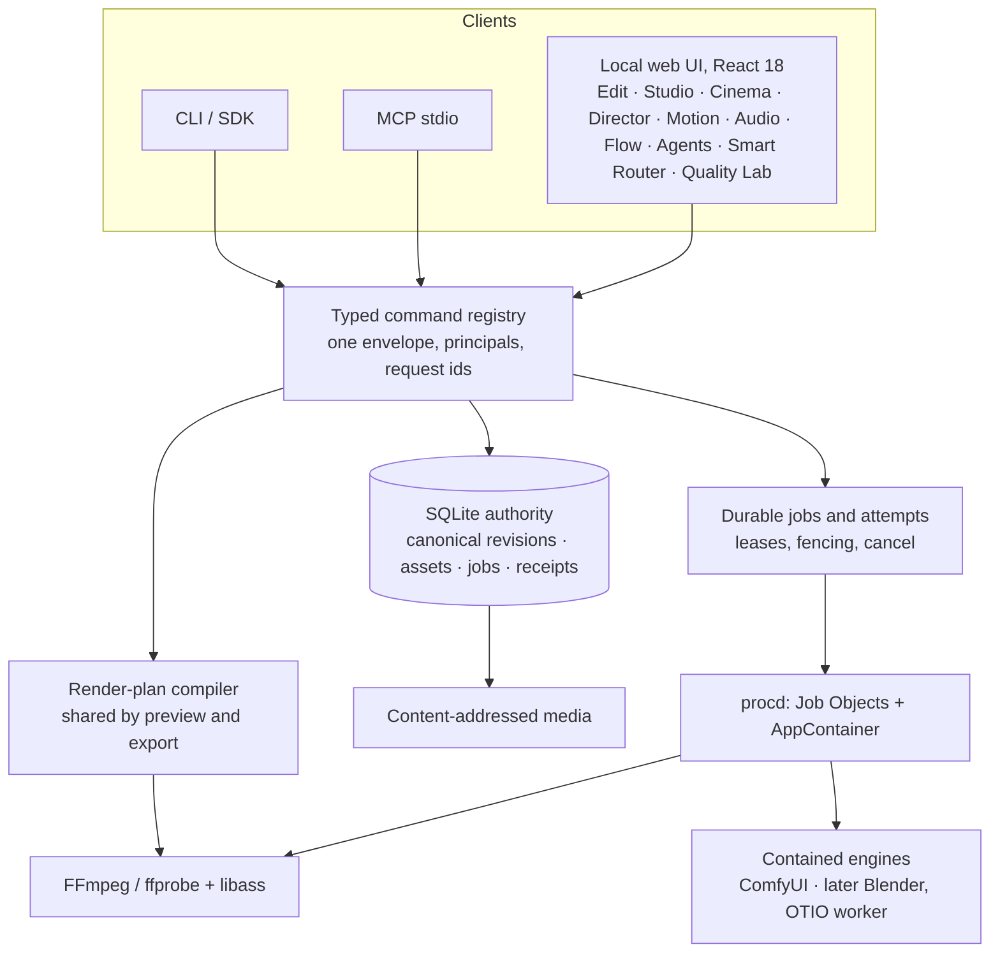

# 06 — Final architecture

D′, unchanged at its core, extended by architecture B ([05](05_ARCHITECTURE_ALTERNATIVES.md)).

## One foundation

| Concern                    | Single owner                                               | Donor code inside it                                     |
| -------------------------- | ---------------------------------------------------------- | -------------------------------------------------------- |
| Project and timeline state | Canonical schema (`core/canonical.ts`) in SQLite revisions | OpenCut algorithms return patches; they never hold state |
| History and undo           | Canonical revisions (revision-bound undo)                  | InvokeAI engine undo is session-local until commit       |
| Media bytes                | Content-addressed store (Skelet)                           | Studio bitmaps and engine outputs enter as assets        |
| Scheduling                 | Durable jobs (`core/jobs.ts`)                              | OpenMontage stages and ComfyUI prompts run as jobs       |
| Processes                  | procd                                                      | ComfyUI and FFmpeg are contained workers                 |
| Rendering                  | FFmpeg plan compiler                                       | Keyframes, retime and sound compile into the same plan   |
| Typography                 | libass with pinned fonts                                   | JASSUB runs the same ASS in the preview                  |
| Interchange                | OTIO writer (original)                                     | OTIO library only as a test oracle                       |

## Workspaces as views

Every workspace is a view over the same entities and commands. None has its own store.

| Workspace    | Entities                                             | Commands (new, prefix `yamakan.`)                                                                                  | Donor core                                          | Capability flag default              |
| ------------ | ---------------------------------------------------- | ------------------------------------------------------------------------------------------------------------------ | --------------------------------------------------- | ------------------------------------ |
| Edit         | project, track, clip (`sound`, `speed`, `animation`) | `timeline.rippleDelete`, `rippleTrim`, `insert`, `groupMove`, `clip.setSound`, `clip.setSpeed`, `clip.setKeyframe` | OpenCut                                             | on after each module validates       |
| Studio       | studioDocument, bitmap assets, takes                 | `studio.open`, `studio.commit`, `studio.export`                                                                    | InvokeAI canvas engine                              | off until M7 passes                  |
| Cinema       | scene3d, camera                                      | `scene.save`, `scene.renderBlocking`                                                                               | ArtCraft camera and schema                          | off until M8–M10 pass                |
| Director     | character, directorRun, stageReceipt                 | `director.start`, `director.approve`, `director.next`                                                              | OpenVideoStudio, OpenMontage                        | off until M11–M12 pass               |
| Motion       | clip animation, engine takes                         | via Edit and engine jobs                                                                                           | OpenCut animation; ComfyUI                          | animation on; engine off (founder F) |
| Audio        | clip sound, gain, fades                              | `clip.setSound`, later loudness                                                                                    | Yamakan (M1); film-editor local mastering candidate | on with M1                           |
| Flow         | directorRun manifests                                | `flow.run` (manifest only)                                                                                         | OpenMontage manifest format                         | off                                  |
| Agents       | principals, lineage                                  | existing MCP plus per-agent principals                                                                             | Ascout/Gomrey rules                                 | on (existing)                        |
| Smart Router | engine capabilities                                  | `router.explain`                                                                                                   | none (original; hard filters before ranking)        | off (no providers)                   |
| Quality Lab  | comparisons, ratings                                 | `quality.compare`                                                                                                  | none (original)                                     | off                                  |

A disabled workspace shows the reason, for example "needs qualified local hardware", and never an empty enabled screen.

## Branding

- **User-facing surfaces say Yamakan:** UI, CLI, MCP tool names, window titles and file metadata (`encoder`/`comment` tags set to Yamakan).
- **Donor names appear only in** `NOTICE`, `notices/`, `docs/`, source-file provenance headers and an About → Open-source notices view (rule 2 in [11](11_SOURCE_PROVENANCE_AND_BRANDING.md)).
- Brand rules and the brand check are in [11](11_SOURCE_PROVENANCE_AND_BRANDING.md).

## Security model additions

- **Engines:**
  - Engines are workers under procd with AppContainer read containment (PR #29). Each gets an ephemeral loopback port.
  - **Not solved yet: an authenticated channel and outbound-network denial.** No real engine runs before gate E-SEC passes ([04](04_EXACT_SOURCE_IMPORT_BLUEPRINT.md) M13).
  - Inputs are granted per job.
  - Outputs are imported through the probe path, never trusted.
- **Browser-side parsers and decoders:**
  - Mediabunny runs in a Worker on `Blob` input only, with a timeout.
  - Images are checked against their probed dimensions before `createImageBitmap`.
  - Neither ever overrides the server probe.
- **Manifests** (Director and Flow) are data, never commands or executables.
- **No donor code** may call `fetch`, open sockets or read `node:` modules inside the browser subtrees.
  - The rule is ported from InvokeAI's dependency policy into `src/studio/boundaries.test.ts`.
  - **The enforcing control** is a page CSP (`connect-src 'self'`; no remote images, fonts or scripts) plus the e2e egress capture.
- **Human-only commands:** agent token create and revoke, Director approval (bound to an output hash and an expiry) and likeness consent grant and revoke. They need the browser principal, which comes only from a single-use, short-lived launch secret, plus the user-presence confirmation Q15 selects. Agent and CLI tokens can never hold these scopes (W4).
