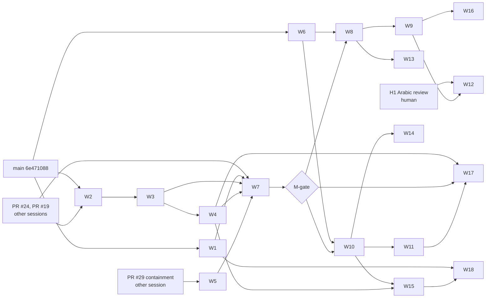

# 08 — Implementation tasks

This is the complete, dependency-aware task list: 18 PRs, W1–W18. Each card can be handed to a development agent as it stands. The module details (donor files, closure, modifications, limits) are in [04](04_EXACT_SOURCE_IMPORT_BLUEPRINT.md). Open assumptions are bounded qualification tests Q1–Q14 ([below](#bounded-qualification-tests-q1q14)); each runs as the first step of the task that owns it.

**Nothing here has been implemented.** The plan was frozen against main `6e471088a56b6bdda4fef29c747167827958a224` ([freeze manifest](../../PLAN_FREEZE_MANIFEST.md)).

## Rules for every task

1. **Start from the live repository.** Fetch, confirm main's SHA and the open PRs, and reconcile with the freeze manifest. If a task's starting files changed since the freeze, re-read them before editing. If the task is already done on main, skip it and record that.
2. **Branch.** Work on one branch per task from current main. Never touch another session's branch.
3. **Gates.** Each PR needs:
   - fresh independent combined and security reviewers;
   - CI success at the exact head;
   - `gh pr merge N --merge --match-head-commit <sha>`;
   - after merging, a check that `origin/main^{tree}` equals `<sha>^{tree}`.

   Merges are normal merge commits only: no squash, no rebase of a published branch, no force push. Mistakes are fixed forward.

4. **Credentials.** GitHub writes use `GH_TOKEN=$(gh auth token -u TheHalfMoon)` per command. Never switch the global account.
5. **No fabricated evidence.** A receipt is committed only from a run that happened, at the head it names.
6. **Common validation** (CI runs the same steps):

   ```bash
   npm ci --ignore-scripts --no-audit --no-fund
   npm run lint
   npm run format:check
   npm run provenance:check
   npm test
   npm run build
   npm run test:e2e
   ```

   Windows-only suites (procd, sandbox, containment) need `npm run build:native` first and run on the Windows development machine.

### Review and analysis tools per task

| Tool                                                                       | When                                                                     | What it counts as                                                                                                                                                   |
| -------------------------------------------------------------------------- | ------------------------------------------------------------------------ | ------------------------------------------------------------------------------------------------------------------------------------------------------------------- |
| Fresh reviewer subagents (combined, security)                              | Every PR                                                                 | The required independent review                                                                                                                                     |
| Jev (2026.919.0)                                                           | Every PR touching `core/`, `server/` or `mcp/`, when a key is configured | Advisory typed classification only, never approval ([tooling](../../ENGINEERING_TOOLING.md))                                                                        |
| Alibaba Open Code Review (CLI 1.12.13, `open-code-review:delegate-review`) | Every PR with TypeScript or Rust changes                                 | Rules and file selection. In delegate mode the host agent does the review, so it is not independent and no model-backed review is claimed. Markdown is unsupported. |
| PStack (ps-review playbook)                                                | Every PR                                                                 | The checklist in [10](10_BENCHMARKS_AND_E2E.md#review-checklist-pstack-playbook-applied-manually), applied by the reviewers                                         |
| Graft (0.21.1, keyless)                                                    | Tasks marked "Graft"                                                     | Caller and dependency map of the touched modules. Run with `--dir` outside the repository, and revert any `.gitignore`/`.ignore` it writes.                         |
| E2E (`npm run test:e2e`, Playwright)                                       | Every PR with UI or command changes                                      | The journeys in [10](10_BENCHMARKS_AND_E2E.md#e2e-journeys-added-to-npm-run-teste2e)                                                                               |
| d1-local                                                                   | Optional triage                                                          | Advisory only. Never approves a PR or clears a security gate.                                                                                                       |

## Dependency graph



**Order of first eligibility:**

1. W1, then W6 (no prerequisites).
2. W2 (after PR #24).
3. W3, then W4.
4. W5 (after PR #29).
5. W7, then the M-gate.
6. W8 and W10.
7. W9, W11, W13, W14 and W15.
8. W16, W17 and W18.
9. W12, once H1 also passes.

**When the graph allows several tasks,** take the lowest number, with one exception: W6 is taken right after W1, because it protects every later import.

---

## Track 1 — MVP release obligations

### W1 — A video clip's own sound

- **Purpose:** close the confirmed MVP defect. Camera footage loses its sound on export, because `core/render/plan.ts:140` emits audio only for sound tracks or audio assets, and `core/canonical.ts:190` forbids video assets on sound tracks.
- **Scope:**
  - In: asset `hasAudio`; clip `sound` on video clips; schema v2 with migration; render plan; preview; one command; UI control; tests.
  - Out: unlinking the sound into a separate clip (P08).
- **Starting files:**
  - `core/canonical.ts` (asset `hasAudio: boolean | null`; clip `sound: {enabled, gainDb, fadeInTicks, fadeOutTicks}`; `schemaVersion` 2);
  - `core/project.ts` (`schemaVersion: z.literal(1)` → 2);
  - `core/migrate.ts`;
  - `core/media.ts` (persist the probe's `hasAudio`, line 133);
  - `core/render/plan.ts`;
  - `core/timeline/operations.ts`;
  - `core/command/registry.ts` (`yamakan.clip.setSound`);
  - `src/donors/film-editor/components/PreviewPlayer.tsx` (unmute, recorded in the ledger);
  - `src/edit-ops.ts`, `src/main.tsx` and `src/i18n.ts`;
  - `tests/export-golden.test.ts`, `tests/migrate.test.ts`, `tests/render-plan.test.ts` and `tests/parity.test.ts`.
- **Donor sources:** none (original work, ladder E; M1 in [04](04_EXACT_SOURCE_IMPORT_BLUEPRINT.md)).
- **Prerequisites:** none.
- **Instructions:**
  1. Run Q1.
  2. Add `hasAudio` to the asset, recorded at import from the probe. Migrated assets get `null` (unknown).
  3. Add `sound` to clips on video tracks. Default it to enabled for new clips whose asset has `hasAudio: true`. Migrated clips get `enabled: false`, so render intent is preserved (agent decision of 2026-10-18).
  4. In `plan.ts`, emit an `AudioInstruction` for each enabled video clip with sound, through the existing gain/fade/delay chain. Track mute and solo apply by the track's kind.
  5. Make the preview play the clip's sound only when enabled. Add the ledger modification line for `PreviewPlayer.tsx`.
  6. Register `yamakan.clip.setSound` (REST and MCP through the registry). Add the UI toggle and gain in both languages.
- **Acceptance tests:**
  - A golden with a 1 kHz tone at a known instant in a video source: heard in the export within ±1 audio frame, under gain and fades.
  - A muted track removes it.
  - A negative fixture (one frame late) fails.
  - A v1 project migrates, and its export's audio is identical to before.
  - Preview/export agreement on enabled and disabled.
  - Parity replay for the new command.
  - `npm run qualify:av-sync` with the video's own sound: drift ≤ 20 ms.
- **Checks:** reviewers, Jev, OCR, PStack, E2E journey 1.
- **Definition of done:** merged under rule 3. `specs/CURRENT.md` and the release proposal's row 8 are updated, and the defect is marked fixed with the receipt.
- **Rollback:**
  - Before merge: close the PR.
  - After merge: a forward fix, or a revert PR. Projects already written as v2 are refused by older builds; restore them from the pre-upgrade backup, which the migration always makes.
- **Next eligible:** W2 (if PR #24 has merged), otherwise W6.

### W2 — Replay-safe recovery commands

- **Purpose:** backup and restore return the original result when retried with the same request id. Jobs left in `reconciliationRequired` (`core/jobs.ts:41`) can be retried or discarded.
- **Scope:**
  - In: `yamakan.workspace.backup` and `yamakan.project.restore` idempotency by request id; new `yamakan.job.retry` and `yamakan.job.discard`.
  - Out: an automatic retry policy.
- **Starting files:** `core/recovery.ts`, `core/jobs.ts`, `core/command/registry.ts`, `core/store.ts` (a receipt table, if not already keyed by request), `tests/recovery.test.ts`, `tests/backup.test.ts`, `tests/jobs.test.ts`.
- **Donor sources:** none.
- **Prerequisites:** PR #24 merged, because it edits `tests/jobs.test.ts`. If #24 is still open, take W6 first.
- **Instructions:**
  1. Store each request's result keyed by request id and a payload digest, in the same transaction as the effect.
  2. The same id and the same payload return the stored result. The same id with a different payload is refused (`CONFLICT`).
  3. `job.retry` creates a new fenced attempt from the job's validated input.
  4. `job.discard` moves the job to `cancelled` and leaves every revision unchanged.
- **Acceptance tests:**
  - Replaying a backup during a concurrent edit returns the first backup's manifest.
  - A kill between effect and response, followed by a replay, returns the original.
  - A retry after a stale lease cannot publish.
  - A discard of a running job is refused.
- **Checks:** reviewers, Jev, OCR, PStack, Graft (callers of `backupWorkspace` and `restoreFromHome`).
- **Definition of done:** merged; the release proposal's open-work items 1–2 are updated.
- **Rollback:** a revert PR. The receipt table is additive, so older builds ignore it.
- **Next eligible:** W3.

### W3 — Canonical integrity

- **Purpose:** three things.
  - Track overlap is refused by canonical validation itself, not only by reducers.
  - Hidden retained VFR originals are collected.
  - Quarantined media can be repaired.
- **Scope:** these three only.
- **Starting files:** `core/canonical.ts` (a refinement over clips per track), `core/media.ts`, `core/recovery.ts` (GC), `core/command/registry.ts` (`yamakan.asset.repair`), `tests/canonical.test.ts`, `tests/derivative.test.ts`, `tests/streaming-import.test.ts`.
- **Prerequisites:** W2.
- **Instructions:**
  1. Add a superRefine that rejects overlapping clips on one track. Make sure migration fixtures with overlaps are refused with a diagnostic, never silently fixed.
  2. GC deletes a hidden original only when no revision within the retention policy references it.
  3. Repair re-probes a quarantined object. It releases the object if the probe passes and keeps it quarantined, with the reason, if not.
- **Acceptance tests:**
  - An overlap fixture is refused at import, migrate and commit.
  - GC under a concurrent import keeps referenced objects (`npm run qualify:large-import` still passes).
  - Repair of a fixed file releases it; repair of a still-bad file keeps it.
- **Checks:** reviewers, Jev, OCR, PStack, Graft (canonical validation callers).
- **Definition of done:** merged; the spec's open items updated.
- **Rollback:** a revert PR. A schema refinement is stricter, so revert it if valid user projects are refused.
- **Next eligible:** W4.

### W4 — Transport-bound principals

- **Purpose:** distinguish the CLI and each MCP agent, which today share `local-client` (`server/api.ts:18`). Undo affects only the writer's own edits.
- **Scope:**
  - In: per-agent tokens; principal derivation; per-writer undo; parity.
  - Out: remote access.
- **Starting files:** `core/command/registry.ts` (Principal type), `server/api.ts`, `server/main.ts` (`authenticate`), `mcp/main.ts`, `cli/main.ts`, `core/timeline/operations.ts` (undo), `tests/parity.test.ts`, `tests/http.test.ts`, `tests/mcp.test.ts`.
- **Prerequisites:** W3.
- **Instructions:**
  1. Run Q2.
  2. The browser user creates named agent tokens (`yamakan.agent.create`, browser principal only). Each is stored hashed with scopes.
  3. The MCP server and CLI present a token. The principal comes from the token, **never** from MCP `clientInfo`.
  4. Undo and redo take the caller's principal and skip other principals' revisions, or conflict if they overlap.
- **Acceptance tests:**
  - Two agents' edits interleave, and each agent's undo reverts only its own.
  - A forged `clientInfo` name does not change the principal.
  - A revoked token is refused.
  - Parity replay passes with distinct principals.
- **Checks:** reviewers (the security reviewer must review principal derivation), Jev, OCR, PStack, E2E.
- **Definition of done:** merged; the release proposal's principal item closed.
- **Rollback:** a revert PR; the `local-client` principal remains as before.
- **Next eligible:** W5 (if PR #29 has merged), otherwise W7's prerequisites.

### W5 — Pinned distributable bundle

- **Purpose:** an installable Windows bundle.
  - Contents: Node runtime, FFmpeg/ffprobe, procd, fonts, notices, an SBOM and artifact hashes.
  - Lifecycle: install, update, rollback and uninstall.
  - Title fonts are limited to the pinned files.
- **Scope:**
  - In: the bundle script, installer flow and font restriction.
  - Out: code signing (it needs a certificate purchase, which is founder-only) and auto-update servers.
- **Starting files:**
  - `scripts/bundle.ts` (new);
  - `package.json` (`bundle` script);
  - `NOTICE` and `notices/`;
  - `core/render/fonts.ts` and `core/render/ass.ts` (a fontconfig file listing only the pinned font directory);
  - `tests/bundle.test.ts` (new) and `tests/typography.test.ts`.
- **Prerequisites:** PR #29 merged. Check free disk space (D: had about 10 GiB at the freeze).
- **Instructions:**
  1. Run Q3.
  2. Build into a versioned folder. Record each file's SHA-256 and a CycloneDX SBOM. The FFmpeg build's licence and codec notices come from the exact binary.
  3. Install into `%LOCALAPPDATA%\Yamakan\<version>` with a current-version pointer. Update switches the pointer, rollback switches it back, and uninstall removes binaries but never workspaces.
  4. Make fontconfig use only the pinned fonts. Add a negative control with a substituted font, which must fail the typography golden.
- **Acceptance tests:**
  - Install, update, rollback and uninstall on a scratch profile, with hashes verified at each step.
  - The workspace survives uninstall.
  - The font-substitution control fails.
  - `npm run qualify:typography` passes.
- **Checks:** reviewers, OCR, PStack, Graft (font path callers).
- **Definition of done:** merged. The clean-profile run is H2 (human/admin) and is not part of this task.
- **Rollback:** a revert PR. Installed bundles uninstall cleanly.
- **Next eligible:** W7 (when W1–W4 and PRs #24/#19 are merged).

### W6 — Provenance and brand tooling

- **Purpose:** make every later import enforceable. It also closes the existing do-not-import enforcement gaps.
- **Scope:** M2 in [04](04_EXACT_SOURCE_IMPORT_BLUEPRINT.md). It is exempt from the M-gate.
- **Starting files:**
  - `scripts/provenance.mjs`;
  - `scripts/import-guard.mjs`;
  - `scripts/brand-check.mjs` (new);
  - `docs/provenance/import-policy.json`;
  - `docs/provenance/imports.json` (backfill `license`, `authorization`, `owner` and `tests` for the 25 records);
  - `.github/workflows/qualify.yml`;
  - `tests/provenance.test.ts` (new).
- **Instructions:**
  1. Add the required fields and fail when one is missing.
  2. Add donor roots for every destination in 04.
  3. Add one excluded pattern per do-not-import row, using the real ArtCraft paths.
  4. Add `--diff <source>` (local drift against a clone at the pin), and `--upstream <source>` (lists upstream commits since the pin, for the monthly security check).
  5. Add the brand check over `src/**`, `src/i18n.ts`, `cli/**` and `mcp/**`.
- **Acceptance tests:**
  - Each excluded path, copied at its pin into a scratch tree, fails.
  - A missing field fails.
  - A donor name in a UI string fails.
  - A donor name in `NOTICE` passes.
- **Checks:** reviewers, OCR, PStack.
- **Definition of done:** merged; CI runs the brand check.
- **Rollback:** a revert PR.
- **Next eligible:** the lowest-numbered eligible Track 1 task.

### W7 — Release evidence and harness hygiene

- **Purpose:** produce the release evidence bundle at an exact main head and declare the M-gate.
- **Starting files:**
  - `scripts/qualify-release.ts`;
  - `scripts/qualify-*.ts` (aborted-run cleanup kills process trees with `taskkill /T`, or the service exits when its parent disconnects);
  - `docs/RELEASE_PROPOSAL.md` and `specs/CURRENT.md`.
- **Prerequisites:** W1–W5 and PRs #24 and #19 merged.
- **Instructions:**
  1. Run `npm run qualify:release` on main's head.
  2. Commit the receipt: MP4 and canonical hashes, ffprobe JSON, sampled frames and title regions, the audio report, UI and MCP transcripts, and lifecycle reports.
  3. If every M-gate condition in [07](07_OPTIMIZED_MASTER_PLAN.md#m-gate) holds, record "M-gate passed at `<sha>`" in `specs/CURRENT.md`.
- **Acceptance tests:**
  - The receipt names the head it ran on.
  - An aborted run leaves no process (checked by a process-tree assertion).
- **Definition of done:** merged. The M-gate is declared, or the failing condition is recorded.
- **Rollback:** a revert PR; no product code changes.
- **Next eligible:** W8, then W10.

---

## Track 2 — Expansion (after the M-gate)

Every Track 2 task does three things:

1. It begins by adding its ledger and policy entries with the W6 tooling.
2. It imports donor files byte-identical first, as one commit, with the upstream SHA-256 values recorded.
3. It then adapts them in later commits, so the ledger's `modifications` list is reviewable.

Each module ships behind a capability flag that turns on only when its acceptance tests pass at the exact head.

### W8 — Ripple and group move (M3, M4)

- **Purpose:** ripple delete, ripple trim and insert, plus multi-clip group move with snapping.
- **Donor:** OpenCut Classic `cf5e79e919144200294fb9fed22a222592a0aeea`.
  - `apps/web/src/ripple/{apply,diff,shift,index}.ts`.
  - `apps/web/src/timeline/group-move/{build-group,resolve-move,snap,track-placement,types,index}.ts`.
  - Closure: `timeline/{track-element-update,playhead-snap-source,element-snap-source,animation-snap-points}.ts` and `timeline/placement/compatibility.ts`.
- **Starting files:** `core/donors/opencut/ripple/*`, `core/donors/opencut/group-move/*`, `core/donors/opencut/{snapping,overlap}.ts` (existing), `core/timeline/operations.ts`, `core/command/registry.ts`, `src/edit-ops.ts`, `tests/ripple.test.ts` (new), `tests/group-move.test.ts` (new), `tests/donor-opencut.test.ts`.
- **Prerequisites:** M-gate and W6.
- **Instructions:**
  1. Run Q4.
  2. Import, then adapt per M3/M4: flick ticks, canonical clip subset, patch outputs.
  3. Register `timeline.rippleDelete`, `rippleTrim`, `insert` and `groupMove`.
- **Acceptance tests:** M3/M4 tests in 04; benchmarks in 10; E2E journey 2.
- **Checks:** reviewers, Jev, OCR, PStack, Graft, E2E.
- **Definition of done:** merged; flags on.
- **Rollback:** flags off, or a revert PR. The data model is unchanged.
- **Next eligible:** W9, W10 or W13.

### W9 — Mediabunny waveform and retime (M14, M5)

- **Donors:**
  - `mediabunny@1.61.3`, an npm dependency with exact pin and integrity.
  - OpenCut `apps/web/src/retime/{rate,resolve,split,presets,index,audio-stretch}.ts` and tests `retime/__tests__/{resolve,split}.test.ts` (bun:test → `node:test`).
  - `soundtouchjs@0.3.0`, exact pin.
- **Starting files:** `package.json`, `src/media/demux.ts` (new), `src/donors/film-editor/components/Waveform.tsx`, `core/donors/opencut/retime/*`, `src/donors/opencut/audio-stretch.ts`, `core/canonical.ts` (clip `speed`), `core/render/plan.ts`, `tests/retime.test.ts` (new).
- **Prerequisites:** W8.
- **Instructions:**
  1. Run Q5 and Q6.
  2. Build Mediabunny in a Worker on `Blob` input only.
  3. Make retime rates rational. Export uses `setpts` and an `atempo` chain; the preview uses soundtouchjs.
- **Acceptance tests:** M5/M14 in 04; E2E journey 3; `npm run qualify:playback` and `npm run qualify:av-sync`.
- **Rollback:** flags off; the `speed` field is absent.
- **Next eligible:** W16 or W12.

### W10 — Studio ADR and engine contract (first step of M7, plus M13)

- **Purpose:**
  - Decide the Studio integration by measurement, through Q7–Q10.
  - Land `core/engines/{contract,fake}.ts` with the fake engine.
- **Starting files:** `docs/adr/0003-studio-canvas-engine.md` (new), `core/engines/contract.ts`, `core/engines/fake.ts`, `tests/engines.test.ts` (new).
- **Prerequisites:** M-gate and W6.
- **Instructions:**
  1. Run Q7–Q10 in a throwaway branch and record the results in the ADR.
  2. Choose the primary if they pass, or the fallback ([04](04_EXACT_SOURCE_IMPORT_BLUEPRINT.md) M7).
  3. Land the engine contract. **No real engine runs.** Gate E-SEC and founder decision F are separate.
- **Acceptance tests:**
  - The ADR records every Q result with its measurement.
  - The engine-absent E2E (journey 6) shows a disabled capability and no egress.
- **Rollback:** the ADR records the fallback; the contract is unused until W11.
- **Next eligible:** W11, W14 or W15.

### W11 — Studio canvas engine (M7)

- **Donor:** InvokeAI `ffe9e1a98b19640388d72f88ae0ecadf1bee1717`.
  - `invokeai/frontend/webv2/src/workbench/canvas-engine/**`: 158 source files and 145 test files.
  - The host closure: `platform/browser/{sha256,downloadBlob}.ts`, `platform/core/json.ts`, `platform/ui/modalPresence.ts` and `workbench/mediaReferences.ts`, copied unchanged.
  - `workbench/controlAdapters.ts`, replaced by a Yamakan stub.
- **Starting files:** `src/studio/canvas-engine/**`, `src/studio/host/*`, `src/studio/boundaries.test.ts`, `core/canonical.ts` (`studioDocument`), `core/command/registry.ts` (`studio.open`, `studio.commit`, `studio.export`).
- **Prerequisites:** the W10 ADR is accepted with the primary.
- **Instructions:** follow M7 in 04 exactly: integration boundary, closure, host state, persistence, migration and tests.
- **Acceptance tests:** M7 in 04; E2E journey 4; the inherited tests that run green.
- **Rollback:** the Studio flag stays off; nothing canonical is written until it is on.
- **Next eligible:** W17.

### W12 — JASSUB live title preview (M15)

- **Prerequisites:** W9, and **H1** (native Arabic review of the T7 goldens) recorded as passed.
- **Donor:** `jassub@2.5.20` (pin `dea3d2d3`), exact pin.
- **Starting files:** `src/preview/titles.ts` (new), `src/donors/film-editor/components/PreviewPlayer.tsx`, `core/render/ass.ts` (unchanged contract).
- **Instructions:**
  1. Run Q11.
  2. Load fonts from the service only; disable `queryLocalFonts`.
- **Acceptance tests:** M15 in 04, including the font negative control.
- **Rollback:** flag off; the server reference still remains.

### W13 — OTIO interchange (M16)

- **Prerequisites:** W8.
- **Starting files:** `core/interchange/otio.ts` (new), `tests/otio.test.ts` (new), and a CI job `otio-oracle` with an exact `opentimelineio` version installed only in that job.
- **Instructions:**
  1. Run Q12.
  2. Export is direct. Import produces a reviewable batch proposal.
- **Acceptance tests:** the M16 round trip; the numeric import limits.
- **Rollback:** remove the command; no data model change.

### W14 — Cinema camera and scene (M8–M10)

- **Prerequisites:** W10.
- **Donor:** ArtCraft `28a39a0de4a2fc2eccc237df2046c24245bd12ab`.
  - `frontend/libs/components/pagescene/src/lib/engine/cameraMath.ts`;
  - `.../engine/EditorState/EditorStateJSON/{object_3d_json,scene_state_json}.ts`;
  - `.../engine/editor/CameraController.ts`.
- **Starting files:** `src/cinema/camera/*`, `core/scene3d.ts`, `package.json` (`three`, exact pin).
- **Acceptance tests:** M8–M10 in 04.
- **Rollback:** the Cinema flag stays off.

### W15 — Director identity and stages (M11, M12)

- **Prerequisites:** W10 and W4.
- **Donors:**
  - OpenVideoStudio `175da9960411fbe740932b0a08d57e32a4a36a18` `studio/identity/*`, `studio/creative/identity.py`;
  - OpenMontage `9327439db69021ab4b0e2776729bf3b58fdb5a87` `schemas/pipelines/**`, `lib/pipeline_loader.py`, the rule functions of `lib/checkpoint.py`.
  - These are translated from Python, not copied byte-identically. The ledger records the source hashes and marks the files `translated`.
- **Starting files:** `core/identity.ts`, `core/identity-format.ts`, `core/director/{manifest,stages}.ts`, `assets/pipelines/*.yaml`, `tests/identity.test.ts`, `tests/director-stages.test.ts`.
- **Acceptance tests:**
  - M11/M12 in 04.
  - Human-only, hash-bound approval.
  - Consent expiry and revocation.
  - E2E journey 5.
- **Rollback:** the Director flag stays off; a manual storyboard remains.

### W16 — Keyframe animation (M6)

- **Prerequisites:** W9.
- **Donor:** the OpenCut `apps/web/src/animation/` files listed in M6, plus test `__tests__/animated-params.test.ts`.
- **Starting files:** `core/donors/opencut/animation/*`, `core/timeline/properties.ts` (new), `core/canonical.ts` (`animation`), `core/render/plan.ts`.
- **Instructions:**
  1. Run Q13 and Q14.
  2. Use one shared sampler for both preview and export.
- **Acceptance tests:** M6 in 04.
- **Rollback:** flag off; the field is absent.

### W17 — Agents and Quality (M17 and original work)

- **Prerequisites:** W4, the M-gate and W11 (Quality Lab compares Studio takes).
- **Donors:** Gomrey `5f299a7a` transition rules and 8 tests; Ascout `ca6b6f51` lineage concepts (founder-owned, `founder-attested`).
- **Starting files:** `core/jobs.ts` (rule table), `core/agents/lineage.ts`, `core/quality/*` (new), `core/router/explain.ts` (new).
- **Acceptance tests:**
  - M17 in 04.
  - Quality Lab: a blinded comparison harness on shared consented inputs, with failure accounting.
  - Router explain returns rejection reasons with no provider enabled.
- **Rollback:** flags off.

### W18 — Audio and Flow follow-ups (P08)

- **Purpose:** three things.
  - Unlink a video clip's sound into its own clip on a sound track.
  - Loudness normalization at export.
  - A read-only Flow view of Director manifests.
- **Prerequisites:** W1, W15 and the M-gate.
- **Donor sources:**
  - None for unlinking and the Flow view (original).
  - Loudness uses FFmpeg's `loudnorm` filter (already shipped).
  - The film editor's `src/services/audioMastering/providers/localAudioMasteringProvider.ts` @ `752cd43d` is read first. It is imported only if it is local-only and passes the same golden; its remote provider stays excluded.
- **Starting files:**
  - `core/canonical.ts`: allow a video asset's sound on a sound track as an unlinked clip, a schema version bump with migration;
  - `core/render/plan.ts` (two-pass `loudnorm` with measured values stored in the plan);
  - `core/timeline/operations.ts`;
  - `src/flow/*` (new view);
  - `tests/export-golden.test.ts`.
- **Acceptance tests:**
  - Unlink then relink restores the exact plan.
  - Loudness lands within ±1 LU of the target on the corpus.
  - The Flow view shows stage state and blocks no command.
- **Checks:** reviewers, Jev, OCR, PStack, E2E.
- **Definition of done:** merged; flags on.
- **Rollback:** flags off; migration-protected schema.
- **Next eligible:** none. Track 2 is complete; the next scope is a new founder decision.

---

## Bounded qualification tests Q1–Q14

Each is run **at implementation time**, as the first step of its task. None has been run. The result is recorded in the task's PR (and, for Q7–Q10, in the Studio ADR).

| Id  | Task | Assumption                                                                                                                                                                                                                                               | Procedure (bounded)                                                                                                                                      | Pass                                                     | Fail → decision                                                                                                                                                                |
| --- | ---- | -------------------------------------------------------------------------------------------------------------------------------------------------------------------------------------------------------------------------------------------------------- | -------------------------------------------------------------------------------------------------------------------------------------------------------- | -------------------------------------------------------- | ------------------------------------------------------------------------------------------------------------------------------------------------------------------------------ |
| Q1  | W1   | The render-time probe's `hasAudio` (`plan.ts:498`) matches the import probe for every corpus file                                                                                                                                                        | Import the existing media corpus and compare both values                                                                                                 | All equal                                                | Use the render-time probe as the authority and store `hasAudio: null` at import                                                                                                |
| Q2  | W4   | MCP stdio clients can pass a token without protocol changes                                                                                                                                                                                              | Start `mcp/main.ts` with a token in `YAMAKAN_AGENT_TOKEN` and call one tool                                                                              | Call authenticated as that agent                         | Read the token from an owner-only file named by `--token-file`                                                                                                                 |
| Q3  | W5   | The pinned FFmpeg's fontconfig can be confined to one directory                                                                                                                                                                                          | Run the typography golden with `FONTCONFIG_FILE` naming only the pinned directory, plus the substituted-font control                                     | Golden passes; control fails                             | Build FFmpeg with libass's direct font provider and no fontconfig, or block release on title substitution (row 8 stays Partial)                                                |
| Q4  | W8   | OpenCut's ripple and group-move maths are unit-agnostic (no `TICKS_PER_SECOND` or seconds conversion; checked statically at the freeze) and stay exact in flicks                                                                                         | Port the modules, then run a property test over 10,000 random edits at 23.976, 25, 29.97 and 60 fps, with `Number.isSafeInteger` checked on every output | No non-integer or unsafe value; total duration conserved | Replace the failing function with an original implementation of the same signature (ladder E for that function only)                                                           |
| Q5  | W9   | Mediabunny decodes the formats Yamakan accepts, in Chromium, within the benchmark                                                                                                                                                                        | Decode one file of each accepted container in the Playwright browser                                                                                     | All decode within 2 s or fail cleanly                    | Keep FFmpeg-derived waveform peaks from the server (present today)                                                                                                             |
| Q6  | W9   | FFmpeg `atempo` chains keep exact duration for rational rates                                                                                                                                                                                            | Export 0.5×, 2× and 3/2× goldens and compare durations                                                                                                   | Duration ±1 audio frame                                  | Use `rubberband` if present in the pinned build; otherwise limit rates to the `atempo`-exact set                                                                               |
| Q7  | W10  | The InvokeAI canvas engine compiles under Yamakan's TypeScript 5.9.3 (donor declares `^7.0.2`) and Vite 8                                                                                                                                                | Copy the subtree plus closure into a throwaway branch; run `tsc --noEmit` and `vite build`                                                               | 0 errors                                                 | Fewer than 50 errors, each syntax-only: fix them as ledgered modifications. More than that, or semantic errors: the fallback (InvokeAI webv1 `controlLayers`, else original C) |
| Q8  | W10  | The engine runs in a React 18 page (the engine imports no React; checked by REA)                                                                                                                                                                         | Mount it in a minimal React 18.3.1 host page and draw one stroke                                                                                         | A stroke renders, no console error                       | Host it in a non-React container element, since it has no React dependency                                                                                                     |
| Q9  | W10  | The inherited tests run under Vitest scoped to `src/studio/**`                                                                                                                                                                                           | Add Vitest as a dev dependency for that scope only; run the node-mode tests                                                                              | ≥ 90% of node-mode test files pass unmodified            | Port the failing test files that cover kept code; drop the rest with a recorded reason                                                                                         |
| Q10 | W10  | Bundle and memory fit                                                                                                                                                                                                                                    | Build and measure the Studio chunk; load a 4096² document with 20 layers                                                                                 | Chunk ≤ 2.5 MiB gzip; stroke p95 ≤ 16 ms                 | Lazy-load Studio; if the latency target fails, record it and keep the flag off                                                                                                 |
| Q11 | W12  | JASSUB's non-threaded build meets the 4 ms/frame target without COOP/COEP headers                                                                                                                                                                        | Render the T7 title fixtures in Playwright                                                                                                               | ≤ 4 ms/frame and SSIM ≥ 0.95                             | Propose COOP/COEP as a reviewed separate change; if rejected, keep the server reference still                                                                                  |
| Q12 | W13  | The OTIO Python library reads Yamakan's rational rate 705,600,000                                                                                                                                                                                        | Round-trip the fixture in the `otio-oracle` job                                                                                                          | Every range identical                                    | Write OTIO at the timeline's frame rate with exact frame integers                                                                                                              |
| Q13 | W16  | Per-frame keyframe values compile to FFmpeg exactly                                                                                                                                                                                                      | Compare an expression-based plan with a `sendcmd`-file plan against the shared sampler on the keyframe fixture                                           | One method matches within ±1 px and ±1 alpha step        | Pre-render the animated layer as a lossless intermediate via the same sampler                                                                                                  |
| Q14 | W16  | OpenCut's animation closure (`@/params`: `ParamValue`, `ParamValues`, `ParamDefinition`, `ChannelEasingMode`, `formatLinearRgba`, `parseColorToLinearRgba`; `@/utils/id`: `generateUUID`; `@/utils/math`: `clamp`) maps onto a Yamakan property registry | Port the closure and run the inherited test                                                                                                              | Inherited test passes                                    | Port the exact donor files of `@/params` used (ledgered) instead of a registry                                                                                                 |
