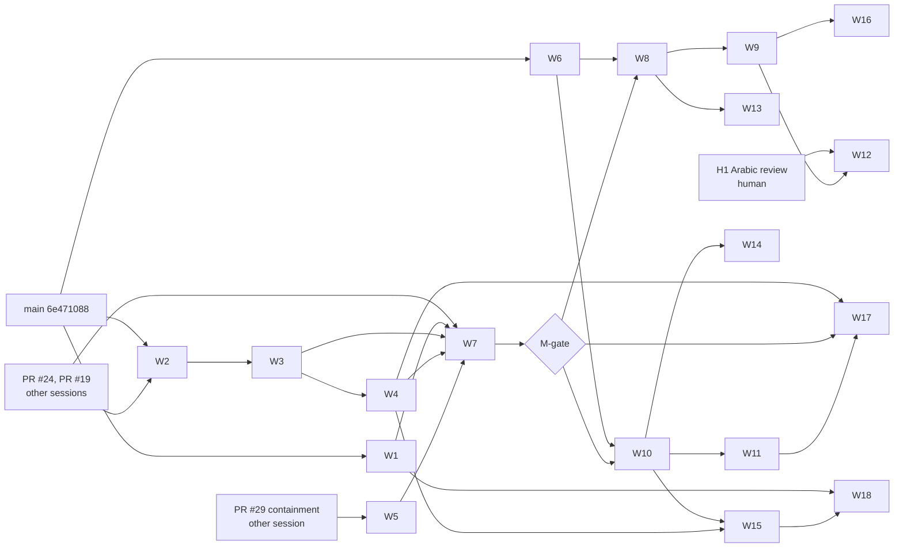

# 08 — Implementation tasks

This is the complete, dependency-aware task list: 18 PRs, W1–W18. Each card can be handed to a development agent as it stands. The module details (donor files, closure, modifications, limits) are in [04](04_EXACT_SOURCE_IMPORT_BLUEPRINT.md). Open assumptions are bounded qualification tests Q1–Q15 ([below](#bounded-qualification-tests-q1q15)); each runs as the first step of the task that owns it.

**Nothing here has been implemented.** The plan was frozen against main `6e471088a56b6bdda4fef29c747167827958a224` ([freeze manifest](../../PLAN_FREEZE_MANIFEST.md)).

## Rules for every task

1. **Start from the live repository.** Fetch, confirm main's SHA and the open PRs, and reconcile with the freeze manifest. If a task's starting files changed since the freeze, re-read them before editing. If the task is already done on main, skip it and record that.
2. **Branch.** Work on one branch per task from current main. Never touch another session's branch.
3. **Gates.** Each PR needs:
   - fresh independent combined and security reviewers;
   - CI success at the exact head;
   - `gh pr merge N --merge --match-head-commit <sha>`;
   - after merging, a check that `origin/main^{tree}` equals `<sha>^{tree}`.

   Merges are normal merge commits only: no squash, no rebase of a published branch, no force push. Mistakes are fixed forward.

4. **Credentials.** GitHub writes use `GH_TOKEN=$(gh auth token -u TheHalfMoon)` per command. Never switch the global account.
5. **No fabricated evidence.** A receipt is committed only from a run that happened, at the head it names.
6. **Common validation** (CI runs the same steps):

   ```bash
   npm ci --ignore-scripts --no-audit --no-fund
   npm run lint
   npm run format:check
   npm run provenance:check
   npm test
   npm run build
   npm run test:e2e
   ```

   Windows-only suites (procd, sandbox, containment) need `npm run build:native` first and run on the Windows development machine.

### Review and analysis tools per task

| Tool                                                                       | When                                                                     | What it counts as                                                                                                                                                   |
| -------------------------------------------------------------------------- | ------------------------------------------------------------------------ | ------------------------------------------------------------------------------------------------------------------------------------------------------------------- |
| Fresh reviewer subagents (combined, security)                              | Every PR                                                                 | The required independent review                                                                                                                                     |
| Jev (2026.919.0)                                                           | Every PR touching `core/`, `server/` or `mcp/`, when a key is configured | Advisory typed classification only, never approval ([tooling](../../ENGINEERING_TOOLING.md))                                                                        |
| Alibaba Open Code Review (CLI 1.12.13, `open-code-review:delegate-review`) | Every PR with TypeScript or Rust changes                                 | Rules and file selection. In delegate mode the host agent does the review, so it is not independent and no model-backed review is claimed. Markdown is unsupported. |
| PStack (ps-review playbook)                                                | Every PR                                                                 | The checklist in [10](10_BENCHMARKS_AND_E2E.md#review-checklist-pstack-playbook-applied-manually), applied by the reviewers                                         |
| Graft (0.21.1, keyless)                                                    | Tasks marked "Graft"                                                     | Caller and dependency map of the touched modules. Run with `--dir` outside the repository, and revert any `.gitignore`/`.ignore` it writes.                         |
| E2E (`npm run test:e2e`, Playwright)                                       | Every PR with UI or command changes                                      | The journeys in [10](10_BENCHMARKS_AND_E2E.md#e2e-journeys-added-to-npm-run-teste2e)                                                                                |
| d1-local                                                                   | Optional triage                                                          | Advisory only. Never approves a PR or clears a security gate.                                                                                                       |

## Dependency graph



**Order of first eligibility:**

1. W1, then W6 (no prerequisites).
2. W2 (after PR #24).
3. W3, then W4.
4. W5 (after PR #29).
5. W7, then the M-gate.
6. W8.
7. W9, W10, W11, W13, W14 and W15.
8. W16, W17 and W18.
9. W12, once H1 also passes.

**When the graph allows several tasks,** take the lowest number, with one exception: W6 is taken right after W1, because it protects every later import.

---

## Track 1 — MVP release obligations

### W1 — A video clip's own sound

- **Purpose:** close the confirmed MVP defect. Camera footage loses its sound on export, because `core/render/plan.ts:140` emits audio only for sound tracks or audio assets, and `core/canonical.ts:190` forbids video assets on sound tracks.
- **Scope:**
  - In: asset `hasAudio`; clip `sound` on video clips; schema v2 with migration; render plan; preview; one command; UI control; tests.
  - Out: unlinking the sound into a separate clip (P08).
- **Starting files:**
  - `core/canonical.ts` (asset `hasAudio: boolean | null`; clip `sound: {enabled, gainDb, fadeInTicks, fadeOutTicks}`; `schemaVersion` 2);
  - `core/project.ts` (`schemaVersion: z.literal(1)` → 2);
  - `core/migrate.ts`;
  - `core/media.ts` (persist the probe's `hasAudio`, line 133);
  - `core/render.ts` (its output verification probe, lines 489–498, is read only, not changed);
  - `core/render/plan.ts`;
  - `core/timeline/operations.ts`;
  - `core/command/registry.ts` (`yamakan.clip.setSound`);
  - `src/editor/components/PreviewPlayer.tsx` (unmute, recorded in the ledger);
  - `src/edit-ops.ts`, `src/main.tsx` and `src/i18n.ts`;
  - `tests/export-golden.test.ts`, `tests/migrate.test.ts`, `tests/render-plan.test.ts` and `tests/parity.test.ts`.
- **Donor sources:** none (original work, ladder E; M1 in [04](04_EXACT_SOURCE_IMPORT_BLUEPRINT.md)).
- **Prerequisites:** none.
- **Instructions:**
  1. Run Q1 (the import probe against an independent audio-stream count).
  2. Add `hasAudio` to the asset, recorded at import from the probe. Migrated assets get `null` (unknown).
  3. Add `sound` to clips on video tracks. Default it to enabled for new clips whose asset has `hasAudio: true`. Migrated clips get `enabled: false`, so render intent is preserved (agent decision of 2026-10-18).
  4. In `plan.ts`, emit an `AudioInstruction` for each enabled video clip with sound, through the existing gain/fade/delay chain. Track mute and solo apply by the track's kind.
  5. Make the preview play the clip's sound only when enabled. Add the ledger modification line for `PreviewPlayer.tsx`.
  6. Register `yamakan.clip.setSound` (REST and MCP through the registry). Add the UI toggle and gain in both languages.
- **Acceptance tests:**
  - A golden with a 1 kHz tone at a known instant in a video source: heard in the export within ±1 audio frame, under gain and fades.
  - A muted track removes it.
  - A negative fixture (one frame late) fails.
  - A v1 project migrates, and its export's audio is identical to before.
  - Preview/export agreement on enabled and disabled.
  - Parity replay for the new command.
  - `npm run qualify:av-sync` with the video's own sound: drift ≤ 20 ms.
- **Checks:** reviewers, Jev, OCR, PStack, E2E journey 1.
- **Definition of done:** merged under rule 3. `specs/CURRENT.md` and the release proposal's row 8 are updated, and the defect is marked fixed with the receipt.
- **Rollback:**
  - Before merge: close the PR.
  - After merge: a forward fix, or a revert PR. Projects already written as v2 are refused by older builds; restore them from the pre-upgrade backup, which the migration always makes.
- **Next eligible:** W6 (the tie-break exception), then W2 once PR #24 has merged.

### W2 — Replay-safe recovery commands

- **Purpose:** backup and restore return the original result when retried with the same request id. Jobs left in `reconciliationRequired` (`core/jobs.ts:41`) can be retried or discarded.
- **Scope:**
  - In: `yamakan.workspace.backup` and `yamakan.project.restore` idempotency by request id; new `yamakan.job.retry` and `yamakan.job.discard`.
  - Out: an automatic retry policy.
- **Starting files:** `core/recovery.ts`, `core/jobs.ts`, `core/command/registry.ts`, `core/store.ts` (a receipt table, if not already keyed by request), `tests/recovery.test.ts`, `tests/backup.test.ts`, `tests/jobs.test.ts`.
- **Donor sources:** none.
- **Prerequisites:** PR #24 merged, because it edits `tests/jobs.test.ts`. If #24 is still open, take W6 first.
- **Instructions:**
  1. Store each request's result keyed by request id and a payload digest, in the same transaction as the effect.
  2. The same id and the same payload return the stored result. The same id with a different payload is refused (`CONFLICT`).
  3. `job.retry` creates a new fenced attempt from the job's validated input.
  4. `job.discard` moves the job to `cancelled` and leaves every revision unchanged.
- **Acceptance tests:**
  - Replaying a backup during a concurrent edit returns the first backup's manifest.
  - A kill between effect and response, followed by a replay, returns the original.
  - A retry after a stale lease cannot publish.
  - A discard of a running job is refused.
- **Checks:** reviewers, Jev, OCR, PStack, Graft (callers of `backupWorkspace` and `restoreFromHome`).
- **Definition of done:** merged; the release proposal's open-work items 1–2 are updated.
- **Rollback:** a revert PR. The receipt table is additive, so older builds ignore it.
- **Next eligible:** W3.

### W3 — Canonical integrity

- **Purpose:** three things.
  - Track overlap is refused by canonical validation itself, not only by reducers.
  - Hidden retained VFR originals are collected.
  - Quarantined media can be repaired.
- **Scope:** these three only.
- **Starting files:** `core/canonical.ts` (a refinement over clips per track), `core/media.ts`, `core/recovery.ts` (GC), `core/command/registry.ts` (`yamakan.asset.repair`), `tests/canonical.test.ts`, `tests/derivative.test.ts`, `tests/streaming-import.test.ts`.
- **Prerequisites:** W2.
- **Instructions:**
  1. Add a superRefine that rejects overlapping clips on one track. Make sure migration fixtures with overlaps are refused with a diagnostic, never silently fixed.
  2. GC deletes a hidden original only when no revision within the retention policy references it.
  3. Repair re-probes a quarantined object. It releases the object if the probe passes and keeps it quarantined, with the reason, if not.
- **Acceptance tests:**
  - An overlap fixture is refused at import, migrate and commit.
  - GC under a concurrent import keeps referenced objects (`npm run qualify:large-import` still passes).
  - Repair of a fixed file releases it; repair of a still-bad file keeps it.
- **Checks:** reviewers, Jev, OCR, PStack, Graft (canonical validation callers).
- **Definition of done:** merged; the spec's open items updated.
- **Rollback:** a revert PR. A schema refinement is stricter, so revert it if valid user projects are refused.
- **Next eligible:** W4.

### W4 — Transport-bound principals and human-only commands

- **Purpose:**
  - Distinguish the CLI and each MCP agent, which today share `local-client` (`server/api.ts:18`, all scopes).
  - Make the human-only commands genuinely unreachable from agents.
  - Undo affects only the writer's own edits.
- **Why the launch secret matters:** on main, the launch secret in the workspace file `launch` (`server/main.ts:121-122`) never expires, can be used more than once, and exchanges for the browser session (`server/main.ts:286`). Any same-account process that can read the workspace could become the browser user.
- **Scope:**
  - In:
    - a single-use, short-lived launch secret;
    - per-agent tokens with create and revoke;
    - scope ceilings;
    - retiring the shared token;
    - user-presence confirmation for human-only commands;
    - per-writer undo;
    - parity.
  - Out: remote access.
- **Starting files:** `core/command/registry.ts` (Principal type and scopes), `server/api.ts`, `server/main.ts` (`writeSecret("launch")`, `authenticate`, session exchange), `mcp/main.ts`, `cli/main.ts`, `core/timeline/operations.ts` (undo), `native/procd/` (only if Q15 selects a native confirmation), `tests/parity.test.ts`, `tests/http.test.ts`, `tests/mcp.test.ts`, `tests/agent-principals.test.ts` (new).
- **Prerequisites:** W3.
- **Instructions:**
  1. Run Q2 and Q15.
  2. **Launch secret:**
     - It is consumed by its first successful exchange.
     - It expires 60 s after it is written.
     - The `launch` file is deleted on use or expiry.
     - A new one is written only when the user runs the launcher (`yamakan open` / the Start-menu shortcut).
  3. **The browser session token** is never written to disk.
  4. **Agent tokens:**
     - `yamakan.agent.create` and `yamakan.agent.revoke` are human-only commands.
     - Each token is stored hashed, with scopes, and shown once.
     - The MCP server and CLI present a token. The principal comes from the token, **never** from MCP `clientInfo`.
  5. **Scope ceiling:** agent and CLI tokens can never hold the human-only scopes:
     - `agent.create` and `agent.revoke`;
     - `director.approve`;
     - consent grant and revoke.
  6. **Human-only commands** additionally require the user-presence confirmation chosen by Q15.
  7. **The shared `local-client` principal:**
     - Reduce it to the legacy commands the CLI uses today.
     - Give the CLI its own token.
     - Remove `local-client` once parity passes without it.
  8. **Undo and redo** take the caller's principal. They skip other principals' revisions, or conflict if they overlap.
- **Acceptance tests:**
  - Undo isolation: two agents' edits interleave, and each agent's undo reverts only its own.
  - Principal derivation:
    - a forged `clientInfo` name does not change the principal;
    - a revoked token is refused.
  - Launch secret:
    - reusing it is refused;
    - after 60 s it is refused;
    - the `launch` file is gone after use.
  - If another process consumes a fresh launch secret first, the browser's exchange fails visibly with "link already used", and the user is told to relaunch.
  - **A process holding a copy of every workspace file** (token, database, any stale launch file) cannot obtain a browser principal, and cannot run `agent.create`, `director.approve` or a consent grant.
  - Parity replay passes with distinct principals.
- **Checks:** reviewers (the security reviewer must review principal derivation and the launch change), Jev, OCR, PStack, Graft (callers of `authenticate`), E2E.
- **Definition of done:**
  - Merged.
  - The release proposal's principal item is closed.
  - The residual risk is recorded in `docs/SECURITY.md`. A same-account process that can drive the user's browser, read its memory, or consume a fresh launch secret within its 60 s window is not separable from the user unless Q15's OS confirmation is in use.
- **Rollback:** a revert PR restores `local-client` and the previous launch behaviour. Issued agent tokens become inert.
- **Next eligible:** W5, once containment is merged (PR #29 or a successor); otherwise W7's remaining prerequisites.

### W5 — Pinned distributable bundle

- **Purpose:** an installable Windows bundle.
  - Contents: Node runtime, FFmpeg/ffprobe, procd, fonts, notices, an SBOM and artifact hashes.
  - Lifecycle: install, update, rollback and uninstall.
  - Title fonts are limited to the pinned files.
- **Scope:**
  - In: the bundle script, installer flow and font restriction.
  - Out: code signing (it needs a certificate purchase, which is founder-only) and auto-update servers.
- **Starting files:**
  - `scripts/bundle.ts` (new);
  - `package.json` (`bundle` script);
  - `NOTICE` and `notices/`;
  - `core/render/fonts.ts` and `core/render/ass.ts` (a fontconfig file listing only the pinned font directory);
  - `tests/bundle.test.ts` (new) and `tests/typography.test.ts`.
- **Prerequisites:** worker read containment merged (PR #29, or a successor PR). Check free disk space (D: had about 10 GiB at the freeze).
- **Instructions:**
  1. Run Q3.
  2. **Sources:** before any download, record each external binary's source URL and expected SHA-256 in `scripts/bundle.ts` (Node runtime, FFmpeg/ffprobe). Refuse a download whose hash differs.
  3. **Build:**
     - Build into a versioned folder.
     - Record each file's SHA-256 in a bundle manifest and write a CycloneDX SBOM.
     - The FFmpeg build's licence and codec notices come from the exact binary.
  4. **Install:**
     - Install into `%LOCALAPPDATA%\Yamakan\<version>`. The current-version pointer is a file, not a junction or link.
     - Install, update and **every launch** verify the binaries procd will run (Node, FFmpeg, ffprobe, procd) against the bundle manifest, which is kept outside the version folder and written only by the installer. A mismatch refuses to start.
  5. **Update, rollback and uninstall:**
     - Update switches the pointer, and rollback switches it back.
     - Moving to an older version needs explicit user confirmation.
     - Uninstall removes binaries only. It never follows reparse points and never deletes a workspace or the recovery home.
  6. **Fonts:** make fontconfig use only the pinned fonts, as Q3 decides. Add the negative controls Q3 names.
- **Acceptance tests:**
  - Install, update, rollback and uninstall on a scratch profile, with hashes verified at each step.
  - The workspace and the recovery home survive uninstall.
  - A tampered FFmpeg binary is refused at launch.
  - A junction planted inside the install folder is not followed by uninstall.
  - A downgrade without confirmation is refused.
  - The font-substitution control fails.
  - `npm run qualify:typography` passes.
- **Checks:** reviewers, OCR, PStack, Graft (font path callers).
- **Definition of done:** merged. The clean-profile run is H2 (human/admin) and is not part of this task.
- **Rollback:** a revert PR. Installed bundles uninstall cleanly.
- **Next eligible:** W7, when W1–W4 are merged and PRs #24 and #19 are resolved (the M-gate rule).

### W6 — Provenance and brand tooling

- **Purpose:** make every later import enforceable. It also closes the existing do-not-import enforcement gaps.
- **Scope:** M2 in [04](04_EXACT_SOURCE_IMPORT_BLUEPRINT.md). It is exempt from the M-gate.
- **Prerequisites:** none.
- **Starting files:**
  - `scripts/provenance.mjs`;
  - `scripts/import-guard.mjs`;
  - `scripts/brand-check.mjs` (new);
  - `docs/provenance/import-policy.json`;
  - `docs/provenance/imports.json` (backfill `license`, `authorization`, `owner` and `tests` for the 25 records);
  - `.github/workflows/qualify.yml`;
  - `tests/provenance.test.ts` (new).
- **Instructions:**
  1. Add the required fields and fail when one is missing.
  2. Add donor roots for every destination in 04.
  3. Add one excluded pattern per do-not-import row, using the real ArtCraft paths.
  4. **Hash denylist.** Add the SHA-256 of every excluded file at its pin. A renamed copy of excluded content fails too.
  5. **Dependency-closure check.** For every imported file, resolve its imports. An import that resolves to an excluded path or to a non-ledgered donor file fails. This is the closure check the [source reuse ledger](../../SOURCE_REUSE_LEDGER.md) requires.
  6. **Drift and upstream commands:**
     - `--diff <source>` reports local drift against a clone at the pin.
     - `--upstream <source>` lists upstream commits since the pin.
  7. **Monthly security check.**
     - Its owner is the owner of each copied subtree.
     - It runs `--upstream` for each copied donor, `npm audit` (CI keeps `--no-audit` only for installs) and an FFmpeg CVE review.
     - It runs as a scheduled workflow within the repository's included Actions minutes. If that would incur any charge, it is run locally instead, because no cloud spend is authorized.
     - Findings become their own PRs.
  8. Add the brand check over `src/**`, `src/i18n.ts`, `cli/**` and `mcp/**`.
- **Acceptance tests:**
  - Each excluded path, copied at its pin into a scratch tree, fails. So does the same content under a new name.
  - An allowed file importing an excluded path fails.
  - A missing field fails.
  - A donor name in a UI string fails.
  - A donor name in `NOTICE` passes.
- **Checks:** reviewers, OCR, PStack.
- **Definition of done:** merged; CI runs the brand check.
- **Rollback:** a revert PR.
- **Next eligible:** the lowest-numbered eligible Track 1 task.

### W7 — Release evidence and harness hygiene

- **Purpose:** produce the release evidence bundle at an exact main head and declare the M-gate.
- **Starting files:**
  - `scripts/qualify-release.ts`;
  - `scripts/qualify-*.ts` (aborted-run cleanup kills process trees with `taskkill /T`, or the service exits when its parent disconnects);
  - `docs/RELEASE_PROPOSAL.md` and `specs/CURRENT.md`.
- **Prerequisites:** W1–W5 merged, and PRs #24 and #19 resolved (see the [M-gate](07_OPTIMIZED_MASTER_PLAN.md#m-gate) for a PR closed unmerged).
- **Instructions:**
  1. Run `npm run qualify:release` on main's head.
  2. Commit the receipt: MP4 and canonical hashes, ffprobe JSON, sampled frames and title regions, the audio report, UI and MCP transcripts, and lifecycle reports.
  3. If every M-gate condition in [07](07_OPTIMIZED_MASTER_PLAN.md#m-gate) holds, record "M-gate passed at `<sha>`" in `specs/CURRENT.md`.
- **Acceptance tests:**
  - The receipt names the head it ran on.
  - An aborted run leaves no process (checked by a process-tree assertion).
- **Checks:** reviewers, OCR, PStack. The receipt itself is the E2E evidence.
- **Definition of done:** merged. The M-gate is declared, or the failing condition is recorded.
- **Rollback:** a revert PR; no product code changes.
- **Next eligible:** W8.

---

## Track 2 — Expansion (after the M-gate)

Every Track 2 task does three things:

1. It begins by adding its ledger and policy entries with the W6 tooling.
2. It imports donor files byte-identical first, as one commit, with the upstream SHA-256 values recorded. (Python donors are translated, not copied.)
3. It then adapts them in later commits, so the ledger's `modifications` list is reviewable.

Each module ships behind a capability flag that turns on only when its acceptance tests pass at the exact head.

**Every Track 2 card shares these defaults unless it says otherwise:**

- **Checks:** fresh reviewers, Jev, OCR, PStack and E2E. Graft is added where a card lists it.
- **Definition of done:**
  - merged under rule 3;
  - the flag on only if every acceptance test passed at the exact head;
  - `specs/CURRENT.md` updated with the module's status and receipts.

### W8 — Ripple and group move (M3, M4)

- **Purpose:** ripple delete, ripple trim and insert, plus multi-clip group move with snapping.
- **Donor:** OpenCut Classic `cf5e79e919144200294fb9fed22a222592a0aeea`.
  - Copied: `apps/web/src/ripple/{apply,diff,shift,index}.ts`; `apps/web/src/timeline/group-move/{build-group,resolve-move,snap,track-placement,types,index}.ts`.
  - **Replaced by adapters, not copied:** `timeline/{track-element-update,playhead-snap-source,element-snap-source,animation-snap-points}.ts` and `timeline/placement/compatibility.ts` (see M4).
- **Starting files:** `core/timeline/ripple/*` (new), `core/timeline/group-move/*` (new), `core/donors/opencut/{snapping,overlap}.ts` (existing), `core/timeline/operations.ts`, `core/command/registry.ts`, `src/edit-ops.ts`, `tests/ripple.test.ts` (new), `tests/group-move.test.ts` (new), `tests/donor-opencut.test.ts`.
- **Prerequisites:** M-gate and W6.
- **Instructions:**
  1. Run Q4.
  2. Import, then adapt per M3/M4: flick ticks, canonical clip subset, patch outputs, adapters for the five replaced files.
  3. Register `timeline.rippleDelete`, `rippleTrim`, `insert` and `groupMove`.
- **Acceptance tests:** M3/M4 tests in 04; benchmarks in 10; E2E journey 2.
- **Checks:** defaults plus Graft (callers of `core/timeline/operations.ts`).
- **Definition of done:** defaults.
- **Rollback:** flags off, or a revert PR. The data model is unchanged.
- **Next eligible:** W9.

### W9 — Mediabunny waveform and retime (M14, M5)

- **Donors:**
  - `mediabunny@1.61.3`, exact pin with integrity.
  - OpenCut `apps/web/src/retime/{rate,resolve,split,presets,index,audio-stretch}.ts` and the tests `retime/__tests__/{resolve,split}.test.ts` (ported from `bun:test` to `node:test`).
  - `soundtouchjs@0.3.0`, exact pin.
- **Starting files:** `package.json`, `src/media/demux.ts` (new), `src/editor/components/Waveform.tsx`, `core/retime/*` (new), `src/audio/audio-stretch.ts` (new), `core/canonical.ts` (clip `speed`), `core/render/plan.ts`, `core/render.ts`, `tests/retime.test.ts` (new).
- **Prerequisites:** W8.
- **Instructions:**
  1. Run Q5 and Q6.
  2. Build Mediabunny in a Worker on `Blob` input only. The Worker is terminated after a 2 s timeout.
  3. **Retime:**
     - Rates are rational.
     - Export uses `setpts` and the `atempo` chain (or Q6's fail decision).
     - The preview uses soundtouchjs.
     - One shared `sourceRange` and `timelineDuration` serve both.
- **Acceptance tests:** M5/M14 in 04; E2E journey 3; `npm run qualify:playback` and `npm run qualify:av-sync`.
- **Checks:** defaults plus Graft (callers of `core/render/plan.ts`).
- **Definition of done:** defaults.
- **Rollback:** flags off; the `speed` field is absent; the dependency is removed in a revert PR.
- **Next eligible:** W10.

### W10 — Studio ADR and engine contract (first step of M7, plus M13)

- **Purpose:** two things.
  - Decide the Studio integration by measurement (Q7a, Q7b, Q8–Q10), against the frozen boundary in M7.
  - Land `core/engines/{contract,fake}.ts` with the fake engine.
- **Starting files:** `docs/adr/0003-studio-canvas-engine.md` (new), `core/engines/contract.ts` (new), `core/engines/fake.ts` (new), `tests/engines.test.ts` (new).
- **Prerequisites:** M-gate and W6.
- **Instructions:**
  1. Run Q7a, Q7b and Q8–Q10 in a throwaway branch (never merged) and record each result with its measurement in the ADR.
  2. Apply each test's binding decision. The primary stays unless Q7a or Q8 fails.
  3. Land the engine contract and the fake engine. **No real engine runs.** Gate E-SEC and founder decision F are separate.
- **Acceptance tests:**
  - The ADR records every Q result.
  - The engine-absent E2E (journey 6) shows a disabled capability and no egress.
  - The fake engine supports cancel, crash retry with fencing, and quarantine of an output that fails the probe.
- **Checks:** defaults.
- **Definition of done:** the ADR is merged with the selected path, and the engine contract is merged with the flag off.
- **Rollback:** the ADR records the fallback; the contract is unused until W11.
- **Next eligible:** W11.

### W11 — Studio canvas engine (M7)

- **Donor:** InvokeAI `ffe9e1a98b19640388d72f88ae0ecadf1bee1717` (paths under `invokeai/frontend/webv2/src/`).
  - **Engine, copied unchanged:** `workbench/canvas-engine/**`, 156 production files (34,647 lines). The SAM files are copied, and the SAM tool stays disabled by capability. The test-support files (`*.testStub.ts`, `*.testing.ts`, `render/golden/goldenHarness.ts`) and the 145 test files are copied for the inherited tests.
  - **Closure, copied unchanged:** `platform/browser/sha256.ts`, `platform/core/json.ts`, `platform/ui/modalPresence.ts`, `workbench/mediaReferences.ts`, `workbench/panZoom.ts` and `workbench/projectEventContracts.ts`.
  - **Reducer seam, copied and adapted:** `workbench/canvasProjectMutations.ts`, `workbench/canvasMigration.ts`, `workbench/canvasLoadContracts.ts` and `workbench/canvasSchemaVersion.ts`.
  - **Replaced by host code:**
    - `workbench/canvasProjectMutationPort.ts`: the port type is kept, and the implementation is the host's.
    - `workbench/controlAdapters.ts`: a stub exporting `CONTROL_ADAPTER_DEFAULTS`, `createDefaultControlAdapter` and `normalizeControlAdapter`.
    - `platform/browser/downloadBlob.ts`: routed to `studio.export`.
    - The type imports `@features/gallery` (`GeneratedImageContract`) and `@workbench/projectContracts` (`ProjectEvent`): minimal Yamakan types.
    - `@workbench/canvasStagingView` (`getCanvasStagingCandidateFingerprint`): a host function over Yamakan takes.
- **Starting files:** `src/studio/canvas-engine/**` (new), `src/studio/host/*` (new), `src/studio/boundaries.test.ts` (new), `core/canonical.ts` (`studioDocument`), `core/command/registry.ts` (`studio.open`, `studio.commit`, `studio.export`), `server/main.ts` (CSP only if needed), `package.json` (`ag-psd`, `perfect-freehand`, Vitest scoped to `src/studio/**`, all exact).
- **Prerequisites:** the W10 ADR is merged and selects the primary.
- **Instructions:** follow M7 in 04 exactly: boundary, closure, host-owned state, undo model, persistence, schema versions 3 and 4, font and image limits, CSP and egress control.
- **Acceptance tests:** M7 in 04; E2E journey 4; the inherited tests under Q9's rule.
- **Checks:** defaults plus Graft (the host seam).
- **Definition of done:** defaults. The Studio flag turns on only after the benchmark targets in 10 are met.
- **Rollback:** the Studio flag stays off; nothing canonical is written until it is on.
- **Next eligible:** W12 if H1 has passed; otherwise W13.

### W12 — JASSUB live title preview (M15)

- **Prerequisites:** W9, and **H1** (native Arabic review of the T7 goldens) recorded as passed.
- **Donor:** `jassub@2.5.20` (pin `dea3d2d3`), exact pin.
- **Starting files:** `src/preview/titles.ts` (new), `src/editor/components/PreviewPlayer.tsx`, `core/render/ass.ts` (unchanged contract), `server/main.ts` (only for a CSP change that Q11 approves).
- **Instructions:**
  1. Run Q11.
  2. Construct JASSUB with:
     - `queryFonts: false`;
     - `defaultFont` and `availableFonts` set to the pinned fonts only;
     - non-zero `libassMemoryLimit` and `libassGlyphLimit`;
     - the worker and wasm served locally by the service.
  3. Any CSP change (`'wasm-unsafe-eval'`) or COOP/COEP header is its own reviewed commit in this PR.
- **Acceptance tests:** M15 in 04, including the font negative control and a check that no local or bundled fallback font is loaded.
- **Checks:** defaults. The security reviewer must approve any CSP or header change.
- **Definition of done:** defaults.
- **Rollback:** flag off; the server reference still remains the primary.
- **Next eligible:** W13.

### W13 — OTIO interchange (M16)

- **Prerequisites:** W8.
- **Starting files:** `core/interchange/otio.ts` (new), `tests/otio.test.ts` (new), and the CI job `otio-oracle` (`.github/workflows/qualify.yml`) with an exact `opentimelineio` version installed only in that job.
- **Instructions:**
  1. Run Q12.
  2. Export is direct.
  3. Import produces a reviewable batch proposal under the numeric limits.
  4. Media references match by asset id or content hash only. `target_url` is never opened.
- **Acceptance tests:** the M16 round trip; the numeric import limits; a document with a remote `target_url` imports with the reference unresolved and no network attempt.
- **Checks:** defaults.
- **Definition of done:** defaults.
- **Rollback:** remove the command; no data model change.
- **Next eligible:** W14.

### W14 — Cinema camera and scene (M8–M10)

- **Prerequisites:** W10.
- **Donor:** ArtCraft `28a39a0de4a2fc2eccc237df2046c24245bd12ab`.
  - `frontend/libs/components/pagescene/src/lib/engine/cameraMath.ts`;
  - `.../engine/EditorState/EditorStateJSON/{object_3d_json,scene_state_json}.ts`;
  - `.../engine/editor/CameraController.ts`.
- **Starting files:** `src/cinema/camera/*` (new), `core/scene3d.ts` (new), `core/command/registry.ts` (`scene.save`), `package.json` (`three`, exact pin).
- **Instructions:**
  1. Import the four files byte-identical.
  2. Adapt `CameraController.ts`: callbacks instead of the event bus; no `@storyteller/*`.
  3. Define `scene3d` with intrinsics, units, Euler order and asset ids, plus the numeric limits in M9.
  4. Register `scene.save`.
- **Acceptance tests:** M8–M10 in 04.
- **Checks:** defaults.
- **Definition of done:** defaults.
- **Rollback:** the Cinema flag stays off.
- **Next eligible:** W15.

### W15 — Director identity and stages (M11, M12)

- **Prerequisites:** W10 and W4.
- **Donors (translated from Python, not copied byte-identically; the ledger records the source hashes and marks the files `translated`):**
  - OpenVideoStudio `175da9960411fbe740932b0a08d57e32a4a36a18`: `studio/identity/models.py`, `studio/identity/assets.py`, `studio/creative/identity.py`, tests `studio/tests/test_identity.py` and `test_identity_provider.py`.
  - OpenMontage `9327439db69021ab4b0e2776729bf3b58fdb5a87`: `schemas/pipelines/pipeline_manifest.schema.json`, `lib/pipeline_loader.py`, the rule functions of `lib/checkpoint.py`, `pipeline_defs/framework-smoke.yaml`, and the tests named in M12.
- **Starting files:** `core/identity.ts` (new), `core/identity-format.ts` (new), `core/director/{manifest,stages}.ts` (new), `assets/pipelines/*.yaml` (new), `core/command/registry.ts` (`director.start`, `director.approve`, `director.next`, consent grant and revoke), `tests/identity.test.ts` (new), `tests/director-stages.test.ts` (new).
- **Instructions:**
  1. Translate the contracts to zod, keyed by asset ids.
  2. Implement consent with version, purpose, expiry, revocation and the invalidation of derived outputs.
  3. Translate the stage rules onto durable jobs and revisions.
  4. Make `director.approve` and the consent grant/revoke commands **human-only** (W4's scope ceiling and user presence), with approvals bound to the output hash and an expiry.
- **Acceptance tests:**
  - M11/M12 in 04.
  - An agent principal is refused for approval and for consent grant/revoke.
  - Consent expiry and revocation.
  - E2E journey 5.
- **Checks:** defaults. The security reviewer must review approvals and consent.
- **Definition of done:** defaults.
- **Rollback:** the Director flag stays off; a manual storyboard remains.
- **Next eligible:** W16.

### W16 — Keyframe animation (M6)

- **Prerequisites:** W9.
- **Donor:** the OpenCut `apps/web/src/animation/` files listed in M6, plus the test `__tests__/animated-params.test.ts`.
- **Starting files:** `core/animation/*` (new), `core/timeline/properties.ts` (new), `core/canonical.ts` (`animation`), `core/render/plan.ts`, `src/editor/components/PreviewPlayer.tsx`.
- **Instructions:**
  1. Run Q13 and Q14.
  2. Use one shared sampler for both preview and export.
  3. Compile per Q13's result.
- **Acceptance tests:** M6 in 04.
- **Checks:** defaults plus Graft (callers of `core/render/plan.ts`).
- **Definition of done:** defaults.
- **Rollback:** flag off; the field is absent.
- **Next eligible:** W17.

### W17 — Agents and Quality (M17 and original work)

- **Prerequisites:** W4, the M-gate and W11 (Quality Lab compares Studio takes).
- **Donors:** Gomrey `5f299a7a6174ad3a1180f827778db5f4400a4d71` transition rules and their 8 tests; Ascout `ca6b6f514e5a8881e2cfa2789b5e5ea43e3aaaad` lineage concepts. Both are founder-owned (`founder-attested`).
- **Starting files:** `core/jobs.ts` (rule table), `core/agents/lineage.ts` (new), `core/quality/*` (new), `core/router/explain.ts` (new), `core/command/registry.ts`.
- **Instructions:**
  1. Import the Gomrey rule module and its tests, and apply the rules inside the SQLite transaction.
  2. Build lineage views from Ascout's contracts.
  3. Build the Quality Lab harness: shared consented inputs, blinded ratings, failure and attempt accounting.
  4. Router explain hard-filters eligibility before any ranking and returns rejection reasons. With no provider enabled, it ranks nothing.
- **Acceptance tests:**
  - M17 in 04: each refused transition leaves the row unchanged.
  - Quality Lab: the blinded comparison is reproducible.
  - Router explain returns rejection reasons with no provider enabled.
- **Checks:** defaults.
- **Definition of done:** defaults.
- **Rollback:** flags off.
- **Next eligible:** W18.

### W18 — Audio and Flow follow-ups (P08)

- **Purpose:** three things.
  - Unlink a video clip's sound into its own clip on a sound track.
  - Loudness normalization at export.
  - A read-only Flow view of Director manifests.
- **Prerequisites:** W1, W15 and the M-gate.
- **Donor sources:**
  - None for unlinking and the Flow view (original).
  - Loudness uses FFmpeg's `loudnorm` filter (already shipped).
  - The film editor's `src/services/audioMastering/providers/localAudioMasteringProvider.ts` @ `752cd43d` is read first. It is imported only if it is local-only and passes the same golden; its remote provider stays excluded.
- **Starting files:**
  - `core/canonical.ts`: allow a video asset's sound on a sound track as an unlinked clip, a schema version bump with migration;
  - `core/render/plan.ts` (two-pass `loudnorm` with measured values stored in the plan);
  - `core/timeline/operations.ts`;
  - `src/flow/*` (new view);
  - `tests/export-golden.test.ts`.
- **Acceptance tests:**
  - Unlink then relink restores the exact plan.
  - Loudness lands within ±1 LU of the target on the corpus.
  - The Flow view shows stage state and blocks no command.
- **Checks:** reviewers, Jev, OCR, PStack, E2E.
- **Definition of done:** merged; flags on.
- **Rollback:** flags off; migration-protected schema.
- **Next eligible:** none. Track 2 is complete; the next scope is a new founder decision.

---

## Bounded qualification tests Q1–Q15

Each is run **at implementation time**, as the first step of its task. None has been run. The result is recorded in the task's PR (and, for Q7a, Q7b and Q8–Q10, in the Studio ADR). The fail decision is binding.

| Id  | Task | Assumption                                                                                                                                                                                                                                               | Procedure (bounded)                                                                                                                                                                                                                | Pass                                                                                                     | Fail → decision                                                                                                                                                                                                                                                                                                                                                                                                                                                                                         |
| --- | ---- | -------------------------------------------------------------------------------------------------------------------------------------------------------------------------------------------------------------------------------------------------------- | ---------------------------------------------------------------------------------------------------------------------------------------------------------------------------------------------------------------------------------- | -------------------------------------------------------------------------------------------------------- | ------------------------------------------------------------------------------------------------------------------------------------------------------------------------------------------------------------------------------------------------------------------------------------------------------------------------------------------------------------------------------------------------------------------------------------------------------------------------------------------------------- |
| Q1  | W1   | The import probe's `hasAudio` (`core/media.ts:133`) is correct for every corpus file. It is the only source-side audio probe; `core/render.ts:489-498` probes the **rendered output**                                                                    | For each file in the existing media corpus, compare `hasAudio` with an independent count of audio streams from the pinned ffprobe (`-select_streams a -show_entries stream=index`), run in the same contained worker               | Equal for every file                                                                                     | Derive `hasAudio` at import from that audio-stream count, and fail any file whose probes disagree as MEDIA_INVALID with a diagnostic                                                                                                                                                                                                                                                                                                                                                                    |
| Q2  | W4   | MCP stdio clients can pass a token without protocol changes                                                                                                                                                                                              | Start `mcp/main.ts` with a token in `YAMAKAN_AGENT_TOKEN` and call one tool                                                                                                                                                        | The call is authenticated as that agent                                                                  | Read the token from an owner-only file named by `--token-file`                                                                                                                                                                                                                                                                                                                                                                                                                                          |
| Q3  | W5   | The pinned FFmpeg's fontconfig can be confined to one directory                                                                                                                                                                                          | Run the typography golden with `FONTCONFIG_FILE`, set through procd's scrubbed environment, naming only the pinned directory. Add the substituted-font control and a control placing a font only in `%WINDIR%\Fonts`               | Golden passes; both controls fail                                                                        | Build FFmpeg with libass's direct font provider and no fontconfig; if that is not possible, release stays blocked on title substitution (row 8 Partial)                                                                                                                                                                                                                                                                                                                                                 |
| Q4  | W8   | OpenCut's ripple and group-move maths are unit-agnostic (no `TICKS_PER_SECOND` or seconds conversion; checked statically at the freeze) and stay exact in flicks                                                                                         | Port the modules, then run a property test over 10,000 random edits at 23.976, 25, 29.97 and 60 fps, checking `Number.isSafeInteger` on every output                                                                               | No non-integer or unsafe value; total duration conserved                                                 | Replace each failing function with an original one of the same signature (ladder E for that function only)                                                                                                                                                                                                                                                                                                                                                                                              |
| Q5  | W9   | Mediabunny decodes the formats Yamakan accepts, in Chromium, within the benchmark                                                                                                                                                                        | Decode one file of each accepted container in the Playwright browser                                                                                                                                                               | Every file decodes within 2 s                                                                            | For any container that does not, keep the server-derived waveform peaks (present today)                                                                                                                                                                                                                                                                                                                                                                                                                 |
| Q6  | W9   | FFmpeg `atempo` chains keep exact duration for rational rates                                                                                                                                                                                            | Export 0.5×, 2× and 3/2× goldens and compare durations                                                                                                                                                                             | Duration ±1 audio frame                                                                                  | Use `rubberband` if the pinned build has it; otherwise limit rates to the `atempo`-exact set                                                                                                                                                                                                                                                                                                                                                                                                            |
| Q7a | W10  | The InvokeAI engine and its closure (M7) compile under Yamakan's TypeScript 5.9.3 (donor `^7.0.2`), Vite 8 and zod (Yamakan 4.4.3, donor `^4.6.5`)                                                                                                       | In a throwaway branch, copy the engine, closure, shims and reducer seam; run `tsc --noEmit` and `vite build`, first with zod 4.4.3, then with an exact newer 4.x if needed                                                         | 0 errors with either zod version (the lowest passing version is adopted as a reviewed dependency change) | Errors in host code (shims, port, adapted reducer seam) are fixed there and do not count. In engine files, at most 50 syntax-level errors (toolchain syntax only, no logic change) are fixed as ledgered modifications, the only permitted exception to "copied unchanged", and the test passes. Any type error in engine logic, or more than 50 errors in engine files: the **fallback** (webv1 `controlLayers` at the same commit, put through the same Q7a/Q8; if that fails too, original ladder C) |
| Q7b | W10  | The reducer seam (`canvasProjectMutations.ts`, `canvasMigration.ts`) adapts with only the minimal Yamakan `StudioProject`, `ProjectEvent` and `GeneratedImageContract` types                                                                             | Compile the adapted seam and run its inherited tests                                                                                                                                                                               | Compiles; inherited reducer tests pass                                                                   | Write an original host reducer for the same mutation vocabulary using the engine's `document/*` modules; **the engine stays primary**                                                                                                                                                                                                                                                                                                                                                                   |
| Q8  | W10  | The engine runs in a React 18 page (the engine imports no React; checked by REA)                                                                                                                                                                         | Mount it in a minimal React 18.3.1 host page and draw one stroke                                                                                                                                                                   | A stroke renders with no console error                                                                   | Host it in a plain container element outside React rendering. It has no React dependency, so this is not a fallback to another donor                                                                                                                                                                                                                                                                                                                                                                    |
| Q9  | W10  | The inherited tests run under Vitest scoped to `src/studio/**`                                                                                                                                                                                           | Add Vitest (exact) as a dev dependency for that scope only. Run the node-mode tests, excluding from the denominator the 22 test and test-support files whose imports reach uncopied modules (listed in M7 field 5)                 | ≥ 90% of the remaining node-mode test files pass unmodified                                              | Port the failing test files that cover kept code. For the 22 excluded files, each one testing kept engine code is rewritten against the host shims (ledgered); each one testing only uncopied code is dropped with the reason recorded. Tests of limits, the dependency policy, seam ownership or the loader **may never be dropped**                                                                                                                                                                   |
| Q10 | W10  | Bundle and memory fit                                                                                                                                                                                                                                    | Build and measure the Studio chunk; load a 4096² document with 20 layers                                                                                                                                                           | Chunk ≤ 2.5 MiB gzip; stroke p95 ≤ 16 ms                                                                 | Lazy-load Studio; if the latency target still fails, record it and keep the flag off                                                                                                                                                                                                                                                                                                                                                                                                                    |
| Q11 | W12  | JASSUB's non-threaded build meets the 4 ms/frame target without COOP/COEP, with only `'wasm-unsafe-eval'` added to the CSP                                                                                                                               | Render the T7 title fixtures in Playwright                                                                                                                                                                                         | ≤ 4 ms/frame and SSIM ≥ 0.95                                                                             | Propose COOP/COEP as a separately reviewed change; if it is rejected, keep the server reference still                                                                                                                                                                                                                                                                                                                                                                                                   |
| Q12 | W13  | The OTIO Python library reads Yamakan's rational rate 705,600,000                                                                                                                                                                                        | Round-trip the fixture in the `otio-oracle` job                                                                                                                                                                                    | Every range identical                                                                                    | Write OTIO at the timeline's frame rate with exact frame integers                                                                                                                                                                                                                                                                                                                                                                                                                                       |
| Q13 | W16  | Per-frame keyframe values compile to FFmpeg exactly                                                                                                                                                                                                      | Compare an expression-based plan with a `sendcmd`-file plan against the shared sampler on the keyframe fixture                                                                                                                     | One method matches within ±1 px and ±1 alpha step                                                        | Pre-render the animated layer as a lossless intermediate through the same sampler                                                                                                                                                                                                                                                                                                                                                                                                                       |
| Q14 | W16  | OpenCut's animation closure (`@/params`: `ParamValue`, `ParamValues`, `ParamDefinition`, `ChannelEasingMode`, `formatLinearRgba`, `parseColorToLinearRgba`; `@/utils/id`: `generateUUID`; `@/utils/math`: `clamp`) maps onto a Yamakan property registry | Port the closure and run the inherited test                                                                                                                                                                                        | The inherited test passes                                                                                | Port the exact donor files of `@/params` that are used (ledgered) instead of a registry                                                                                                                                                                                                                                                                                                                                                                                                                 |
| Q15 | W4   | Windows can provide a user-presence confirmation that no API caller can satisfy                                                                                                                                                                          | On Profile A, call `Windows.Security.Credentials.UI.UserConsentVerifier` from the native helper; if unavailable, `CredUIPromptForWindowsCredentials`. Yamakan never sees the credential; the OS returns only verified or cancelled | One method shows an OS prompt and returns verified or cancelled                                          | Human-only commands stay limited to the browser principal (with the single-use launch secret). The residual same-account risk is recorded in `docs/SECURITY.md` and the release notes: a same-account process could drive the browser, or consume a fresh launch secret within its 60 s window before the browser does (the browser's exchange then fails visibly with "link already used")                                                                                                             |
